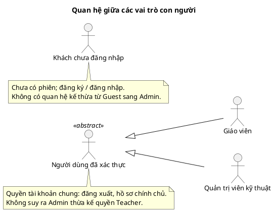

# Các tác nhân của hệ thống

> Quesy · Bản phân tích nghiệp vụ 1.0 · Ngày 17/11/2026
> Trạng thái: bản đặc tả đề xuất, không phải báo cáo chức năng đã triển khai.

## Danh mục và ranh giới

Theo M04, tr. 1–4, actor nằm ngoài ranh giới Quesy và có tương tác với hệ thống. Một người có thể đóng nhiều vai ở các phiên/ngữ cảnh khác nhau. Vai trò không đồng nghĩa với một bảng người dùng.

| Mã | Tác nhân | Loại | Mục tiêu và giới hạn |
|---|---|---|---|
| KH | Khách chưa đăng nhập | Con người trong trạng thái chưa có phiên | Đăng ký khi được mở và đăng nhập; không được truy cập kho riêng. |
| ND | Người dùng đã xác thực | Vai trò khái quát, trừu tượng | Đăng xuất và quản lý hồ sơ chính chủ. GV và QT chuyên biệt hóa ND; đây không phải vai trò cấp riêng. |
| GV | Giáo viên | Tác nhân chính | Tự tổ chức kho, hậu kiểm, biên soạn, xuất đề và chấm dữ liệu của mình; không có cấp trường/tổ bộ môn. |
| QT | Quản trị viên kỹ thuật | Tác nhân chính | Quản trị tài khoản, danh mục chung, hồ sơ, dịch vụ, nhật ký và sao lưu. Không thừa kế quyền đọc nội dung của mọi GV. |
| AI | Dịch vụ AI/OCR ngoài Quesy | Hệ thống hỗ trợ bên ngoài | Nhận vùng nguồn/ngữ cảnh tối thiểu; trả nội dung hoặc đề xuất. Không tự duyệt câu và không là người chịu trách nhiệm đáp án. |
| BC | Bộ biên dịch tài liệu ngoài Quesy | Hệ thống hỗ trợ bên ngoài | Nhận tài liệu cần biên dịch; trả tệp hoặc lỗi. Quesy kiểm tra đầu ra và quyền tải. Có thể thay bằng bộ biên dịch nội bộ khi thiết kế triển khai. |
| SL | Kho sao lưu ngoài Quesy | Hệ thống hỗ trợ bên ngoài | Nhận/đọc bản sao đã bảo vệ theo danh mục và mã kiểm tra. Không truy cập trực tiếp giao diện giáo viên. |

Học sinh là chủ thể dữ liệu trong danh sách và bài làm, không là tác nhân sử dụng trong phạm vi đã chốt. Ngân hàng câu hỏi, cơ sở dữ liệu, bộ kiểm tra QA, hàng đợi, chức năng OMR và Pass 1/Pass 2 là trách nhiệm nội bộ; không vẽ chúng thành actor. Dịch vụ AI chỉ là actor khi thật sự nằm ngoài ranh giới Quesy; một tiến trình AI nội bộ không tự trở thành actor.

## Chuyên biệt hóa và quyền dùng chung

## Ma trận quyền chức năng

| Chức năng | Khách | Giáo viên | Quản trị kỹ thuật |
|---|---|---|---|
| UC-01 Đăng ký | Theo chính sách | Không cần trong phiên đã có | Không tự đăng ký quyền quản trị |
| UC-02 Đăng nhập | Có | Trước khi có phiên | Trước khi có phiên |
| UC-03–UC-04 Tài khoản chính chủ | Không | Có | Có |
| UC-05–UC-24 Nghiệp vụ giáo viên | Không | Trong không gian riêng | Chỉ khi được cấp thêm vai GV; vẫn trong không gian của mình |
| UC-25 Tài khoản/quyền | Không | Không | Theo quyền quản trị, có bảo vệ quản trị viên cuối |
| UC-26–UC-27 Danh mục/hồ sơ chung | Không | Đọc phiên bản được công bố; không sửa chung | Soạn, kiểm tra và công bố có phiên bản |
| UC-28–UC-30 Vận hành | Không | Không; xem lỗi riêng trong luồng nghiệp vụ | Theo quyền vận hành, có nhật ký |
| Nội dung kho cá nhân người khác | Không | Không | Không mặc nhiên có quyền |

## Tương tác với hệ thống ngoài

| Tác nhân hỗ trợ | Use Case liên quan | Dữ liệu gửi/nhận | Khi không sẵn sàng |
|---|---|---|---|
| AI/OCR | UC-11, UC-17; UC-18 qua UC-17; thử ở UC-28 | Vùng nguồn, ngữ cảnh được chọn / bản trích xuất, gợi ý, lỗi | Giữ nháp và tiến độ; nhập/sửa tay vẫn làm được |
| Bộ biên dịch | UC-10 (PDF), UC-16, UC-21; thử ở UC-28 | Nội dung và tài sản được phép / tệp và vị trí lỗi | Không công bố tệp lỗi; giữ nội dung đã lưu |
| Kho sao lưu | UC-30 | Bản sao được bảo vệ, danh mục / dữ liệu phục hồi và mã kiểm tra | Giữ bản hoạt động; ghi trạng thái sao lưu/khôi phục lỗi |

M03 giúp kiểm tra dữ liệu ra/vào; M05 giúp tách trách nhiệm logic khỏi lựa chọn đặt dịch vụ trên máy nào. Chưa chốt số máy chủ, công nghệ xác thực hay nhà cung cấp.
