# Sơ đồ Use Case chi tiết

> Quesy · Bản phân tích nghiệp vụ 1.0 · Ngày 17/11/2026
> Trạng thái: bản đặc tả đề xuất, không phải báo cáo chức năng đã triển khai.

## Nguyên tắc đọc

Theo M04, actor nằm ngoài khung Quesy, Use Case đặt trong khung; association thể hiện tham gia, không phải thứ tự thời gian. Đăng nhập là tiền điều kiện cho nghiệp vụ, không vẽ `include Đăng nhập` vào mọi chức năng. UC-15 `include` UC-14 vì lần sinh đề nào cũng phải kiểm tra đáp ứng. UC-17 và UC-18 `extend` UC-16 tại các điểm mở rộng đã nêu, khi giáo viên yêu cầu. Hậu kiểm UC-12 tiếp nối tác vụ UC-11 nhưng không `include` vì được khởi tạo riêng sau khi kết quả đã sẵn sàng.

Chi tiết luồng tham chiếu tài liệu 08. Mỗi sơ đồ dưới đây thể hiện một mục tiêu; riêng actor ND khái quát quyền tài khoản chung của cả GV và QT. Sơ đồ không biến từng bước xử lý nội bộ thành một Use Case mới.


## Tác nhân khách trước đăng nhập

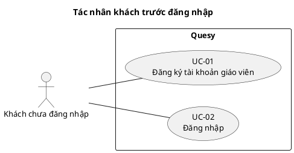


## Tác nhân giáo viên

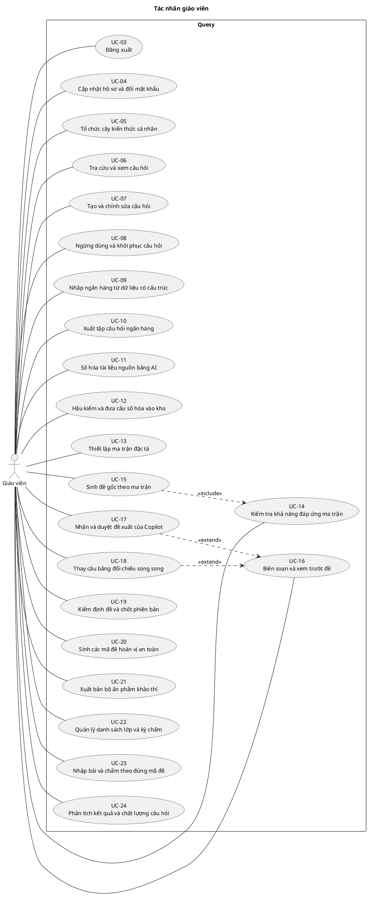


## Tác nhân quản trị viên

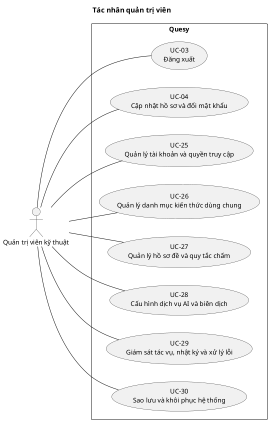


## Tác nhân hỗ trợ ngoài Quesy

Các actor AI/OCR, bộ biên dịch và kho sao lưu liên kết với từng chức năng tương ứng dưới đây; không chủ động duyệt nội dung. UC-28 thử một dịch vụ đã chọn, vai trò hỗ trợ được chuyên biệt theo AI hoặc biên dịch trong lần thử đó.

<a id="ucd-01"></a>
## UC-01 — Đăng ký tài khoản giáo viên

Tác nhân chính: Khách chưa đăng nhập. Đặc tả: [UC-01](08_MO_TA_USE_CASE.md#uc-01).

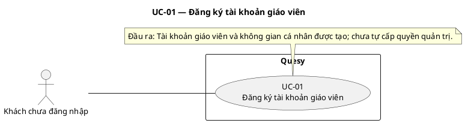


<a id="ucd-02"></a>
## UC-02 — Đăng nhập

Tác nhân chính: Khách chưa đăng nhập. Đặc tả: [UC-02](08_MO_TA_USE_CASE.md#uc-02).

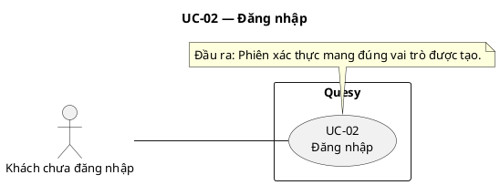


<a id="ucd-03"></a>
## UC-03 — Đăng xuất

Tác nhân chính: Người dùng đã xác thực. Đặc tả: [UC-03](08_MO_TA_USE_CASE.md#uc-03).

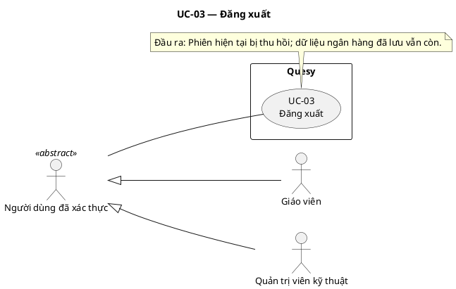


<a id="ucd-04"></a>
## UC-04 — Cập nhật hồ sơ và đổi mật khẩu

Tác nhân chính: Người dùng đã xác thực. Đặc tả: [UC-04](08_MO_TA_USE_CASE.md#uc-04).

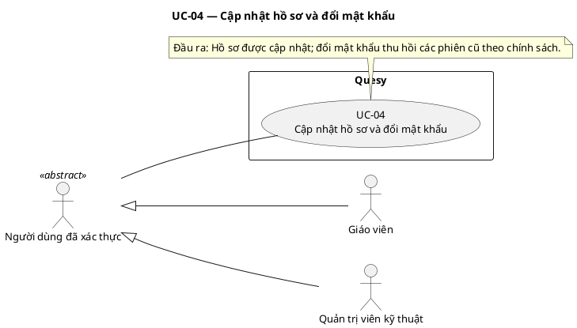


<a id="ucd-05"></a>
## UC-05 — Tổ chức cây kiến thức cá nhân

Tác nhân chính: Giáo viên. Đặc tả: [UC-05](08_MO_TA_USE_CASE.md#uc-05).


<a id="ucd-06"></a>
## UC-06 — Tra cứu và xem câu hỏi

Tác nhân chính: Giáo viên. Đặc tả: [UC-06](08_MO_TA_USE_CASE.md#uc-06).

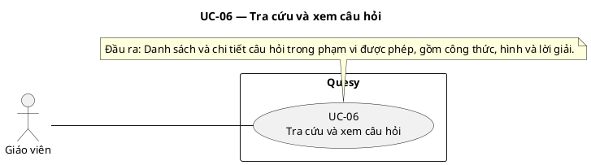


<a id="ucd-07"></a>
## UC-07 — Tạo và chỉnh sửa câu hỏi

Tác nhân chính: Giáo viên. Đặc tả: [UC-07](08_MO_TA_USE_CASE.md#uc-07).

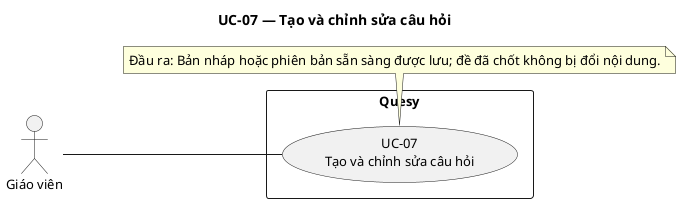


<a id="ucd-08"></a>
## UC-08 — Ngừng dùng và khôi phục câu hỏi

Tác nhân chính: Giáo viên. Đặc tả: [UC-08](08_MO_TA_USE_CASE.md#uc-08).

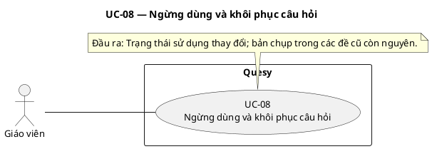


<a id="ucd-09"></a>
## UC-09 — Nhập ngân hàng từ dữ liệu có cấu trúc

Tác nhân chính: Giáo viên. Đặc tả: [UC-09](08_MO_TA_USE_CASE.md#uc-09).

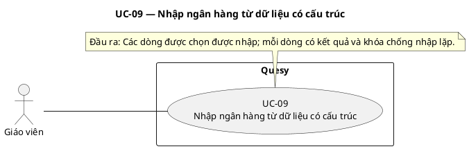


<a id="ucd-10"></a>
## UC-10 — Xuất tập câu hỏi ngân hàng

Tác nhân chính: Giáo viên. Đặc tả: [UC-10](08_MO_TA_USE_CASE.md#uc-10).

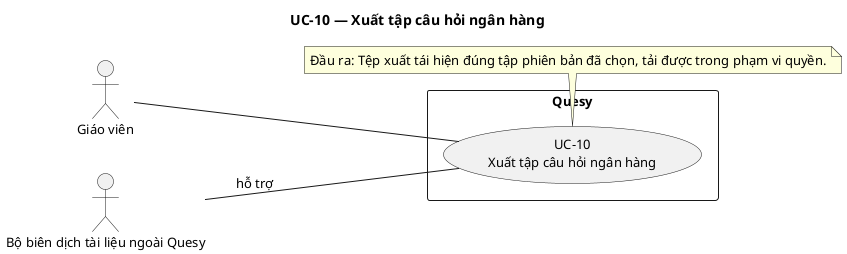


<a id="ucd-11"></a>
## UC-11 — Số hóa tài liệu nguồn bằng AI

Tác nhân chính: Giáo viên. Đặc tả: [UC-11](08_MO_TA_USE_CASE.md#uc-11).

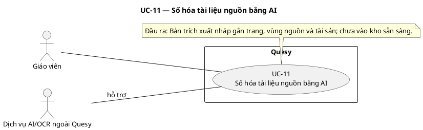


<a id="ucd-12"></a>
## UC-12 — Hậu kiểm và đưa câu số hóa vào kho

Tác nhân chính: Giáo viên. Đặc tả: [UC-12](08_MO_TA_USE_CASE.md#uc-12).

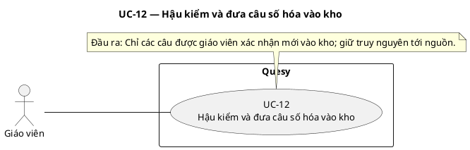


<a id="ucd-13"></a>
## UC-13 — Thiết lập ma trận đặc tả

Tác nhân chính: Giáo viên. Đặc tả: [UC-13](08_MO_TA_USE_CASE.md#uc-13).

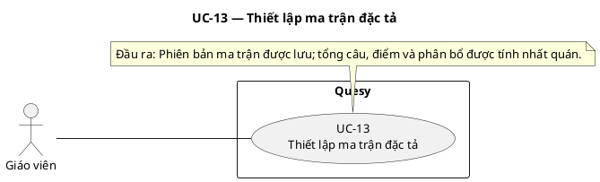


<a id="ucd-14"></a>
## UC-14 — Kiểm tra khả năng đáp ứng ma trận

Tác nhân chính: Giáo viên. Đặc tả: [UC-14](08_MO_TA_USE_CASE.md#uc-14).

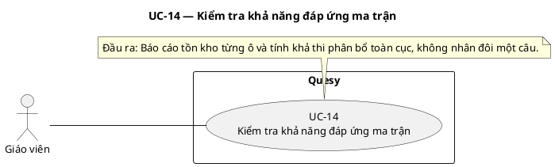


<a id="ucd-15"></a>
## UC-15 — Sinh đề gốc theo ma trận

Tác nhân chính: Giáo viên. Đặc tả: [UC-15](08_MO_TA_USE_CASE.md#uc-15).

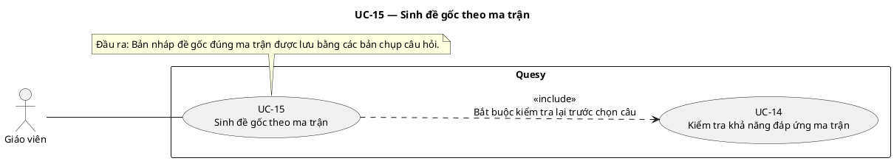


<a id="ucd-16"></a>
## UC-16 — Biên soạn và xem trước đề

Tác nhân chính: Giáo viên. Đặc tả: [UC-16](08_MO_TA_USE_CASE.md#uc-16).

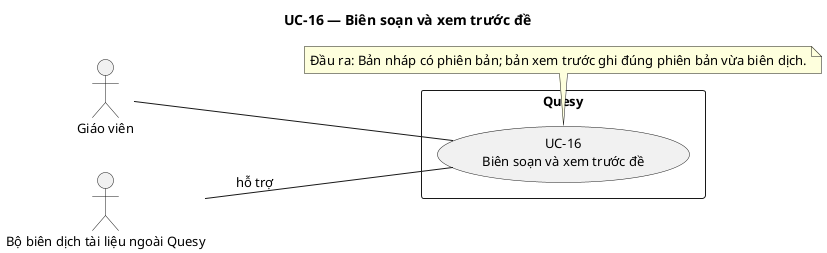


<a id="ucd-17"></a>
## UC-17 — Nhận và duyệt đề xuất của Copilot

Tác nhân chính: Giáo viên. Đặc tả: [UC-17](08_MO_TA_USE_CASE.md#uc-17).

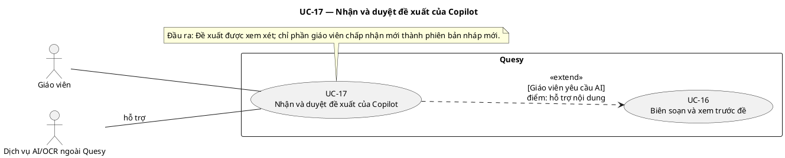


<a id="ucd-18"></a>
## UC-18 — Thay câu bằng đối chiếu song song

Tác nhân chính: Giáo viên. Đặc tả: [UC-18](08_MO_TA_USE_CASE.md#uc-18).

```plantuml
@startuml UCD_18
skinparam defaultFontName Segoe UI
skinparam shadowing false
skinparam defaultFontSize 13
title UC-18 — Thay câu bằng đối chiếu song song
left to right direction
actor "Giáo viên" as A
rectangle "Quesy" {
  usecase "UC-18\nThay câu bằng đối chiếu song song" as UC_18
  usecase "UC-16\nBiên soạn và xem trước đề" as UC_16
  UC_18 ..> UC_16 : <<extend>>\n[Giáo viên muốn thay câu]\nđiểm: thay câu đã chọn
}
A -- UC_18
note bottom of UC_18
  Đầu ra: Câu được thay sau xác nhận; đề vẫn đúng ma trận và có phiên bản mới.
end note
@enduml
```


<a id="ucd-19"></a>
## UC-19 — Kiểm định đề và chốt phiên bản

Tác nhân chính: Giáo viên. Đặc tả: [UC-19](08_MO_TA_USE_CASE.md#uc-19).

```plantuml
@startuml UCD_19
skinparam defaultFontName Segoe UI
skinparam shadowing false
skinparam defaultFontSize 13
title UC-19 — Kiểm định đề và chốt phiên bản
left to right direction
actor "Giáo viên" as A
rectangle "Quesy" {
  usecase "UC-19\nKiểm định đề và chốt phiên bản" as UC_19
}
A -- UC_19
note bottom of UC_19
  Đầu ra: Báo cáo QA gắn phiên bản; chỉ đề không có lỗi chặn mới được chốt.
end note
@enduml
```


<a id="ucd-20"></a>
## UC-20 — Sinh các mã đề hoán vị an toàn

Tác nhân chính: Giáo viên. Đặc tả: [UC-20](08_MO_TA_USE_CASE.md#uc-20).

```plantuml
@startuml UCD_20
skinparam defaultFontName Segoe UI
skinparam shadowing false
skinparam defaultFontSize 13
title UC-20 — Sinh các mã đề hoán vị an toàn
left to right direction
actor "Giáo viên" as A
rectangle "Quesy" {
  usecase "UC-20\nSinh các mã đề hoán vị an toàn" as UC_20
}
A -- UC_20
note bottom of UC_20
  Đầu ra: Bộ mã đề và ánh xạ đáp án được lưu sau kiểm chứng đầy đủ bất biến.
end note
@enduml
```


<a id="ucd-21"></a>
## UC-21 — Xuất bản bộ ấn phẩm khảo thí

Tác nhân chính: Giáo viên. Đặc tả: [UC-21](08_MO_TA_USE_CASE.md#uc-21).

```plantuml
@startuml UCD_21
skinparam defaultFontName Segoe UI
skinparam shadowing false
skinparam defaultFontSize 13
title UC-21 — Xuất bản bộ ấn phẩm khảo thí
left to right direction
actor "Giáo viên" as A
actor "Bộ biên dịch tài liệu ngoài Quesy" as E
rectangle "Quesy" {
  usecase "UC-21\nXuất bản bộ ấn phẩm khảo thí" as UC_21
}
A -- UC_21
E -- UC_21 : hỗ trợ
note bottom of UC_21
  Đầu ra: Ấn phẩm đúng phiên bản và mã đề; đề phát cho học sinh không lộ đáp án.
end note
@enduml
```


<a id="ucd-22"></a>
## UC-22 — Quản lý danh sách lớp và kỳ chấm

Tác nhân chính: Giáo viên. Đặc tả: [UC-22](08_MO_TA_USE_CASE.md#uc-22).

```plantuml
@startuml UCD_22
skinparam defaultFontName Segoe UI
skinparam shadowing false
skinparam defaultFontSize 13
title UC-22 — Quản lý danh sách lớp và kỳ chấm
left to right direction
actor "Giáo viên" as A
rectangle "Quesy" {
  usecase "UC-22\nQuản lý danh sách lớp và kỳ chấm" as UC_22
}
A -- UC_22
note bottom of UC_22
  Đầu ra: Danh sách lớp và kỳ chấm hợp lệ, không trùng mã trong cùng danh sách.
end note
@enduml
```


<a id="ucd-23"></a>
## UC-23 — Nhập bài và chấm theo đúng mã đề

Tác nhân chính: Giáo viên. Đặc tả: [UC-23](08_MO_TA_USE_CASE.md#uc-23).

```plantuml
@startuml UCD_23
skinparam defaultFontName Segoe UI
skinparam shadowing false
skinparam defaultFontSize 13
title UC-23 — Nhập bài và chấm theo đúng mã đề
left to right direction
actor "Giáo viên" as A
rectangle "Quesy" {
  usecase "UC-23\nNhập bài và chấm theo đúng mã đề" as UC_23
}
A -- UC_23
note bottom of UC_23
  Đầu ra: Kết quả và chi tiết điểm gắn bài, mã đề và phiên bản hồ sơ chấm; có lịch sử sửa.
end note
@enduml
```


<a id="ucd-24"></a>
## UC-24 — Phân tích kết quả và chất lượng câu hỏi

Tác nhân chính: Giáo viên. Đặc tả: [UC-24](08_MO_TA_USE_CASE.md#uc-24).

```plantuml
@startuml UCD_24
skinparam defaultFontName Segoe UI
skinparam shadowing false
skinparam defaultFontSize 13
title UC-24 — Phân tích kết quả và chất lượng câu hỏi
left to right direction
actor "Giáo viên" as A
rectangle "Quesy" {
  usecase "UC-24\nPhân tích kết quả và chất lượng câu hỏi" as UC_24
}
A -- UC_24
note bottom of UC_24
  Đầu ra: Phổ điểm và chỉ số câu hỏi có mẫu số, nhóm mẫu, phiên bản và cảnh báo giới hạn.
end note
@enduml
```


<a id="ucd-25"></a>
## UC-25 — Quản lý tài khoản và quyền truy cập

Tác nhân chính: Quản trị viên kỹ thuật. Đặc tả: [UC-25](08_MO_TA_USE_CASE.md#uc-25).

```plantuml
@startuml UCD_25
skinparam defaultFontName Segoe UI
skinparam shadowing false
skinparam defaultFontSize 13
title UC-25 — Quản lý tài khoản và quyền truy cập
left to right direction
actor "Quản trị viên kỹ thuật" as A
rectangle "Quesy" {
  usecase "UC-25\nQuản lý tài khoản và quyền truy cập" as UC_25
}
A -- UC_25
note bottom of UC_25
  Đầu ra: Tài khoản và quyền được cập nhật có nhật ký; không tạo quyền xem kho riêng mặc định.
end note
@enduml
```


<a id="ucd-26"></a>
## UC-26 — Quản lý danh mục kiến thức dùng chung

Tác nhân chính: Quản trị viên kỹ thuật. Đặc tả: [UC-26](08_MO_TA_USE_CASE.md#uc-26).

```plantuml
@startuml UCD_26
skinparam defaultFontName Segoe UI
skinparam shadowing false
skinparam defaultFontSize 13
title UC-26 — Quản lý danh mục kiến thức dùng chung
left to right direction
actor "Quản trị viên kỹ thuật" as A
rectangle "Quesy" {
  usecase "UC-26\nQuản lý danh mục kiến thức dùng chung" as UC_26
}
A -- UC_26
note bottom of UC_26
  Đầu ra: Danh mục chung có phiên bản được công bố; dữ liệu cá nhân cũ không bị đổi nhãn ngầm.
end note
@enduml
```


<a id="ucd-27"></a>
## UC-27 — Quản lý hồ sơ đề và quy tắc chấm

Tác nhân chính: Quản trị viên kỹ thuật. Đặc tả: [UC-27](08_MO_TA_USE_CASE.md#uc-27).

```plantuml
@startuml UCD_27
skinparam defaultFontName Segoe UI
skinparam shadowing false
skinparam defaultFontSize 13
title UC-27 — Quản lý hồ sơ đề và quy tắc chấm
left to right direction
actor "Quản trị viên kỹ thuật" as A
rectangle "Quesy" {
  usecase "UC-27\nQuản lý hồ sơ đề và quy tắc chấm" as UC_27
}
A -- UC_27
note bottom of UC_27
  Đầu ra: Hồ sơ mới được công bố có phiên bản; đề và điểm cũ giữ quy tắc đã ghim.
end note
@enduml
```


<a id="ucd-28"></a>
## UC-28 — Cấu hình dịch vụ AI và biên dịch

Tác nhân chính: Quản trị viên kỹ thuật. Đặc tả: [UC-28](08_MO_TA_USE_CASE.md#uc-28).

```plantuml
@startuml UCD_28
skinparam defaultFontName Segoe UI
skinparam shadowing false
skinparam defaultFontSize 13
title UC-28 — Cấu hình dịch vụ AI và biên dịch
left to right direction
actor "Quản trị viên kỹ thuật" as A
actor "Dịch vụ AI hoặc biên dịch được thử" as E
rectangle "Quesy" {
  usecase "UC-28\nCấu hình dịch vụ AI và biên dịch" as UC_28
}
A -- UC_28
E -- UC_28 : hỗ trợ
note bottom of UC_28
  Đầu ra: Cấu hình được kiểm tra bằng dữ liệu mẫu, kích hoạt có phiên bản; bí mật được che.
end note
@enduml
```


<a id="ucd-29"></a>
## UC-29 — Giám sát tác vụ, nhật ký và xử lý lỗi

Tác nhân chính: Quản trị viên kỹ thuật. Đặc tả: [UC-29](08_MO_TA_USE_CASE.md#uc-29).

```plantuml
@startuml UCD_29
skinparam defaultFontName Segoe UI
skinparam shadowing false
skinparam defaultFontSize 13
title UC-29 — Giám sát tác vụ, nhật ký và xử lý lỗi
left to right direction
actor "Quản trị viên kỹ thuật" as A
rectangle "Quesy" {
  usecase "UC-29\nGiám sát tác vụ, nhật ký và xử lý lỗi" as UC_29
}
A -- UC_29
note bottom of UC_29
  Đầu ra: Báo cáo vận hành và quyết định xử lý có nhật ký; không tạo kết quả trùng.
end note
@enduml
```


<a id="ucd-30"></a>
## UC-30 — Sao lưu và khôi phục hệ thống

Tác nhân chính: Quản trị viên kỹ thuật. Đặc tả: [UC-30](08_MO_TA_USE_CASE.md#uc-30).

```plantuml
@startuml UCD_30
skinparam defaultFontName Segoe UI
skinparam shadowing false
skinparam defaultFontSize 13
title UC-30 — Sao lưu và khôi phục hệ thống
left to right direction
actor "Quản trị viên kỹ thuật" as A
actor "Kho sao lưu ngoài Quesy" as E
rectangle "Quesy" {
  usecase "UC-30\nSao lưu và khôi phục hệ thống" as UC_30
}
A -- UC_30
E -- UC_30 : hỗ trợ
note bottom of UC_30
  Đầu ra: Bản sao nhất quán được kiểm tra; phục hồi chỉ có hiệu lực sau đối soát, có điểm quay lui.
end note
@enduml
```
