# Sơ đồ hoạt động từng chức năng

> Quesy · Bản phân tích nghiệp vụ 1.0 · Ngày 17/11/2026
> Trạng thái: bản đặc tả đề xuất, không phải báo cáo chức năng đã triển khai.

## Quy ước

Mỗi sơ đồ ACT-nn tương ứng UC-nn. Làn phân trách nhiệm con người, Quesy và dịch vụ ngoài. Nút quyết định có nhãn Có/Không hoặc điều kiện rõ. Các sơ đồ thể hiện luồng chính và điểm từ chối nghiệp vụ; toàn bộ nhánh ngoại lệ bổ sung vẫn nằm trong mô tả Use Case tại tài liệu 08.

Các bước xác nhận là thao tác của người dùng sản phẩm. Kiểm tra phiên bản/quyền áp dụng khi đọc và ghi. Ở luồng có thể lưu nháp, nhánh lỗi chỉ chặn việc chuyển sang trạng thái cao hơn, không xóa nháp đã lưu.


<a id="act-01"></a>
## ACT-01 — Đăng ký tài khoản giáo viên

Đối chiếu: [UC-01](08_MO_TA_USE_CASE.md#uc-01); quy tắc BR-01.

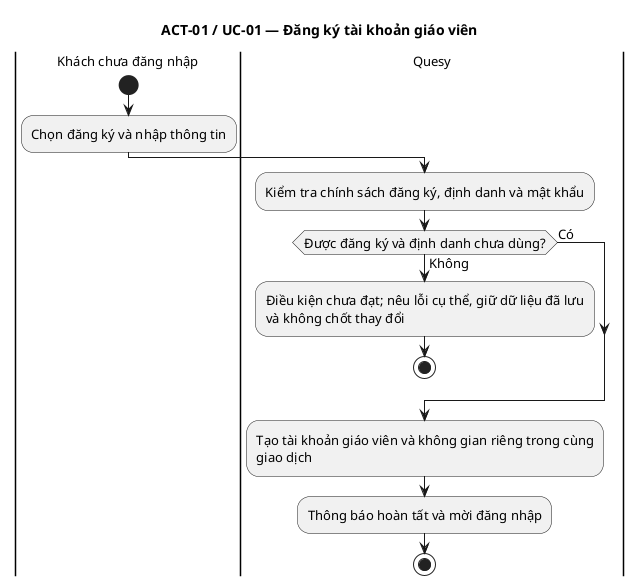


<a id="act-02"></a>
## ACT-02 — Đăng nhập

Đối chiếu: [UC-02](08_MO_TA_USE_CASE.md#uc-02); quy tắc BR-01.

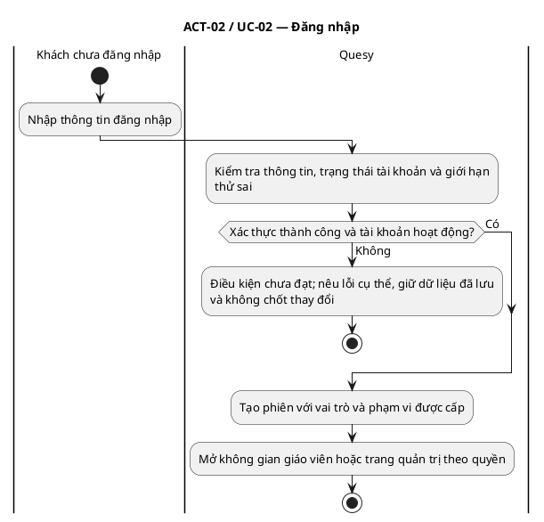


<a id="act-03"></a>
## ACT-03 — Đăng xuất

Đối chiếu: [UC-03](08_MO_TA_USE_CASE.md#uc-03); quy tắc BR-01.

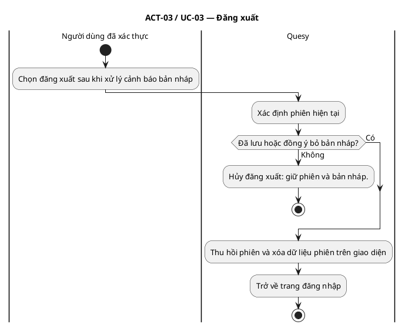


<a id="act-04"></a>
## ACT-04 — Cập nhật hồ sơ và đổi mật khẩu

Đối chiếu: [UC-04](08_MO_TA_USE_CASE.md#uc-04); quy tắc BR-01, BR-02.

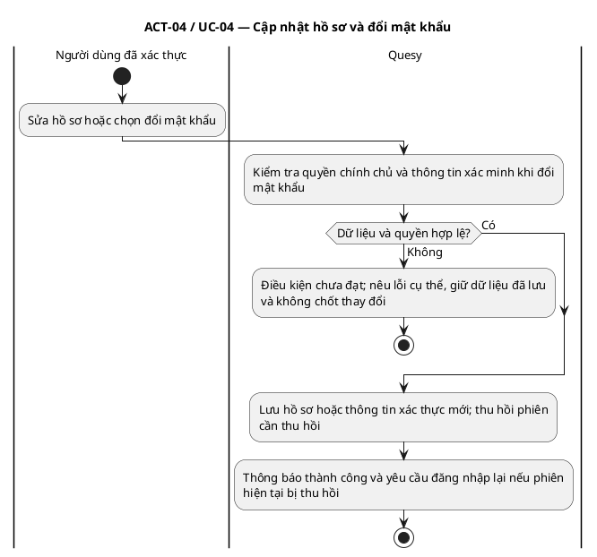


<a id="act-05"></a>
## ACT-05 — Tổ chức cây kiến thức cá nhân

Đối chiếu: [UC-05](08_MO_TA_USE_CASE.md#uc-05); quy tắc BR-01, BR-03.

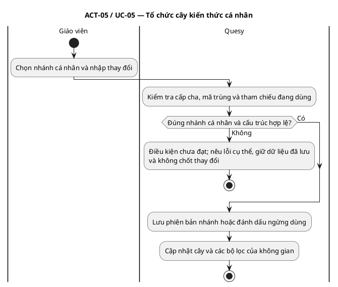


<a id="act-06"></a>
## ACT-06 — Tra cứu và xem câu hỏi

Đối chiếu: [UC-06](08_MO_TA_USE_CASE.md#uc-06); quy tắc BR-01, BR-02.

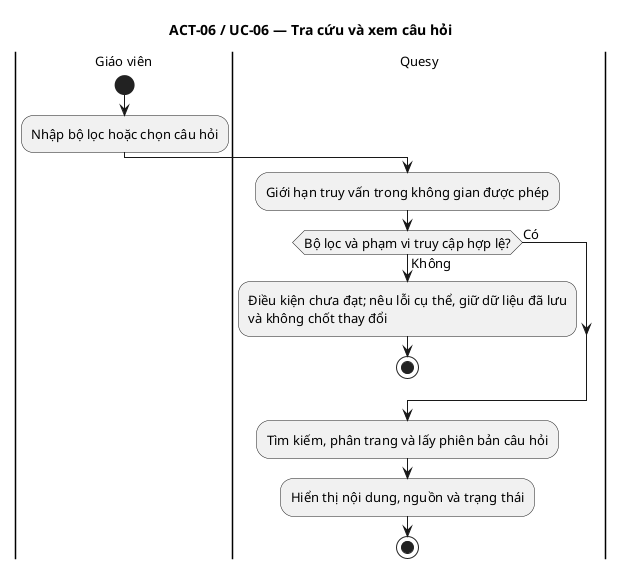


<a id="act-07"></a>
## ACT-07 — Tạo và chỉnh sửa câu hỏi

Đối chiếu: [UC-07](08_MO_TA_USE_CASE.md#uc-07); quy tắc BR-02, BR-04, BR-05.

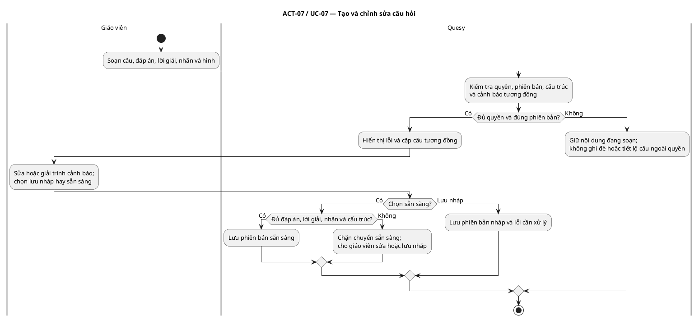


<a id="act-08"></a>
## ACT-08 — Ngừng dùng và khôi phục câu hỏi

Đối chiếu: [UC-08](08_MO_TA_USE_CASE.md#uc-08); quy tắc BR-02, BR-06.

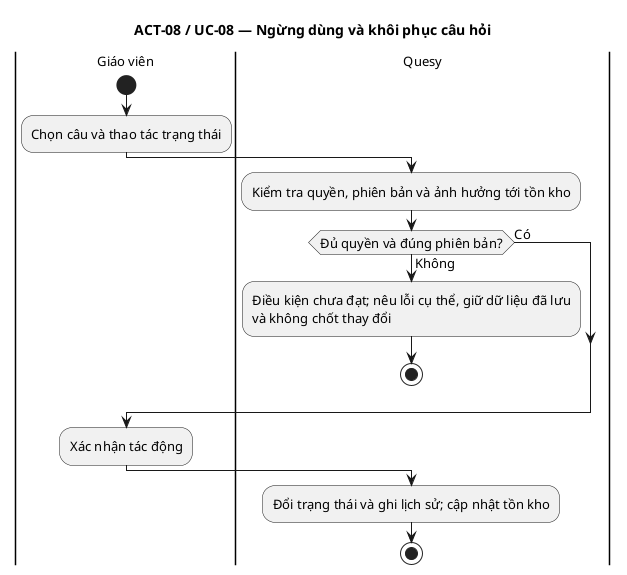


<a id="act-09"></a>
## ACT-09 — Nhập ngân hàng từ dữ liệu có cấu trúc

Đối chiếu: [UC-09](08_MO_TA_USE_CASE.md#uc-09); quy tắc BR-04, BR-05, BR-07.

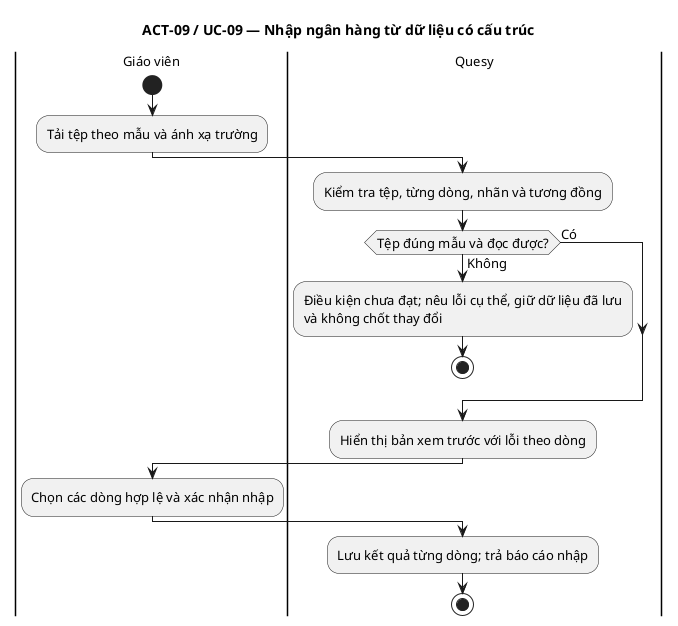


<a id="act-10"></a>
## ACT-10 — Xuất tập câu hỏi ngân hàng

Đối chiếu: [UC-10](08_MO_TA_USE_CASE.md#uc-10); quy tắc BR-01, BR-02, BR-12.

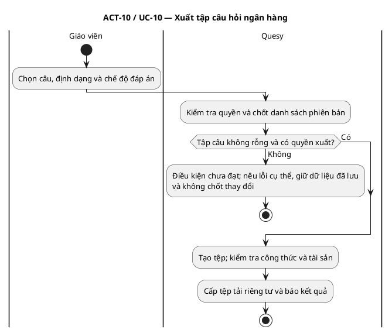


<a id="act-11"></a>
## ACT-11 — Số hóa tài liệu nguồn bằng AI

Đối chiếu: [UC-11](08_MO_TA_USE_CASE.md#uc-11); quy tắc BR-04, BR-05, BR-07, BR-08.

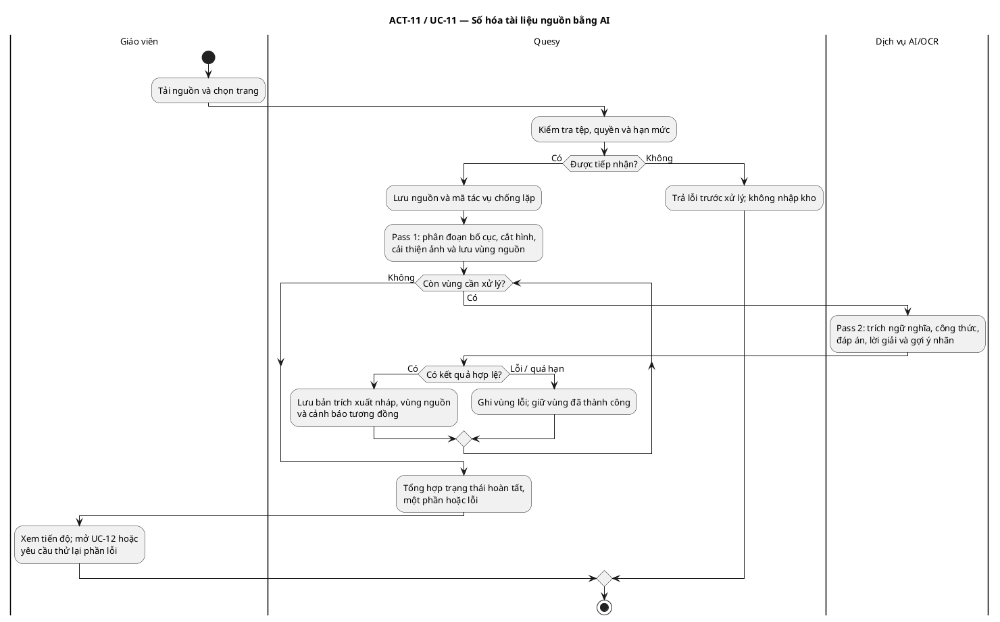


<a id="act-12"></a>
## ACT-12 — Hậu kiểm và đưa câu số hóa vào kho

Đối chiếu: [UC-12](08_MO_TA_USE_CASE.md#uc-12); quy tắc BR-04, BR-05, BR-07, BR-08.

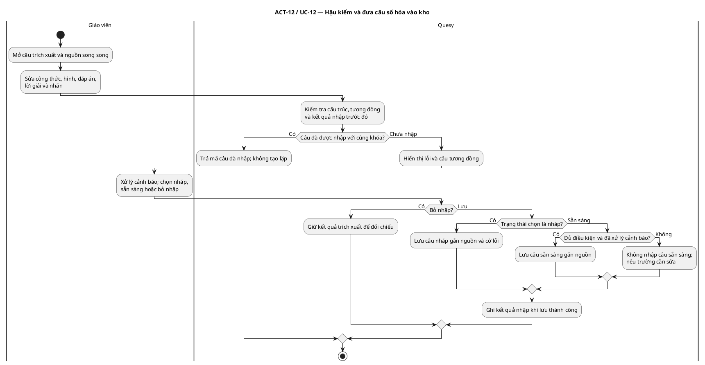


<a id="act-13"></a>
## ACT-13 — Thiết lập ma trận đặc tả

Đối chiếu: [UC-13](08_MO_TA_USE_CASE.md#uc-13); quy tắc BR-03, BR-09, BR-13.

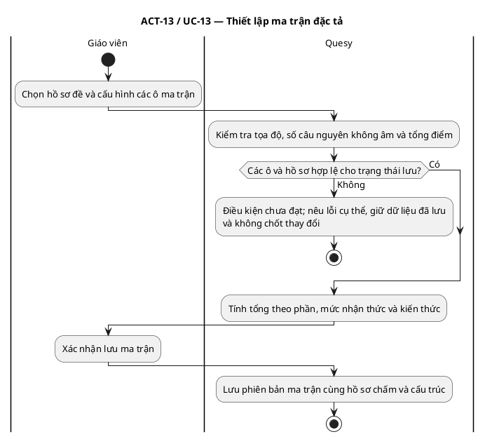


<a id="act-14"></a>
## ACT-14 — Kiểm tra khả năng đáp ứng ma trận

Đối chiếu: [UC-14](08_MO_TA_USE_CASE.md#uc-14); quy tắc BR-06, BR-09.

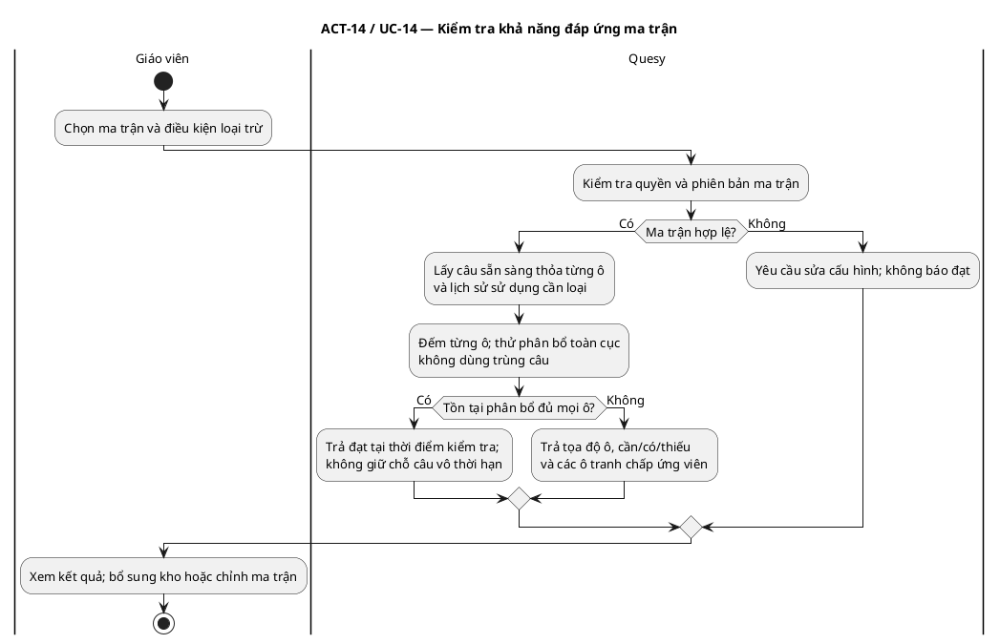


<a id="act-15"></a>
## ACT-15 — Sinh đề gốc theo ma trận

Đối chiếu: [UC-15](08_MO_TA_USE_CASE.md#uc-15); quy tắc BR-02, BR-06, BR-09, BR-10.

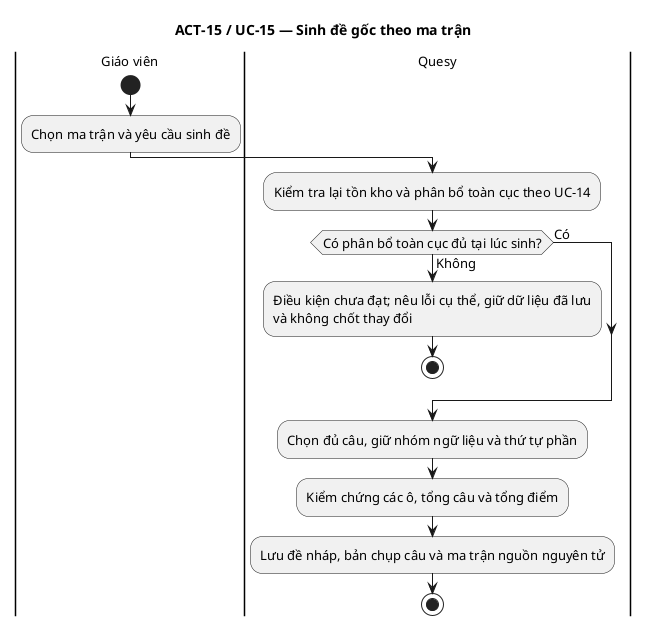


<a id="act-16"></a>
## ACT-16 — Biên soạn và xem trước đề

Đối chiếu: [UC-16](08_MO_TA_USE_CASE.md#uc-16); quy tắc BR-02, BR-04, BR-12.

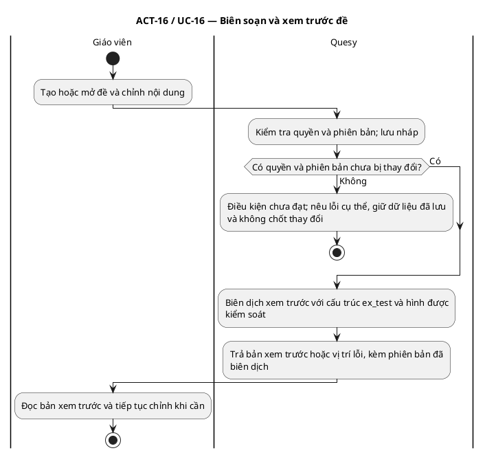


<a id="act-17"></a>
## ACT-17 — Nhận và duyệt đề xuất của Copilot

Đối chiếu: [UC-17](08_MO_TA_USE_CASE.md#uc-17); quy tắc BR-02, BR-08, BR-11.

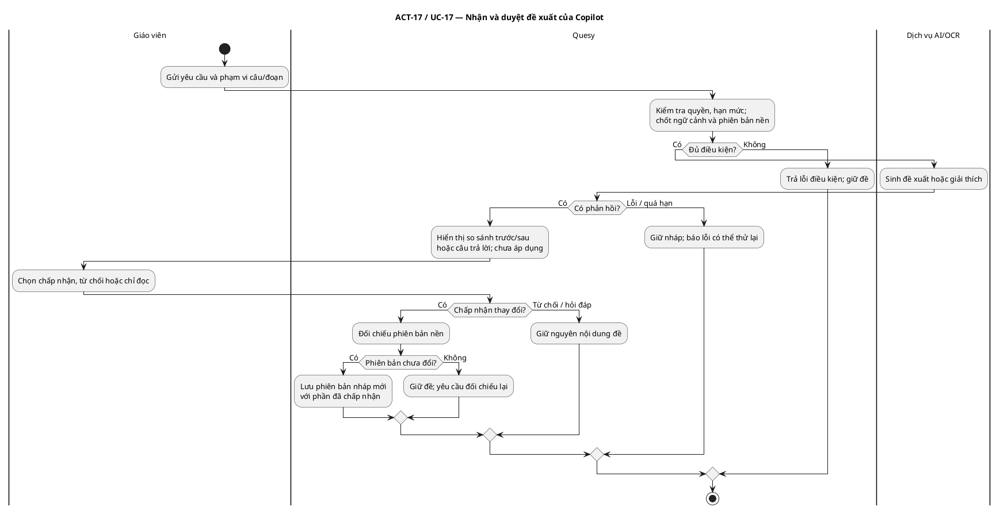


<a id="act-18"></a>
## ACT-18 — Thay câu bằng đối chiếu song song

Đối chiếu: [UC-18](08_MO_TA_USE_CASE.md#uc-18); quy tắc BR-02, BR-09, BR-10, BR-11.

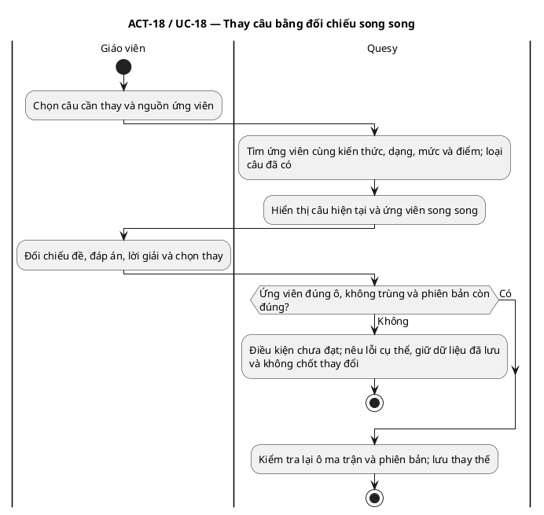


<a id="act-19"></a>
## ACT-19 — Kiểm định đề và chốt phiên bản

Đối chiếu: [UC-19](08_MO_TA_USE_CASE.md#uc-19); quy tắc BR-04, BR-09, BR-11, BR-12.

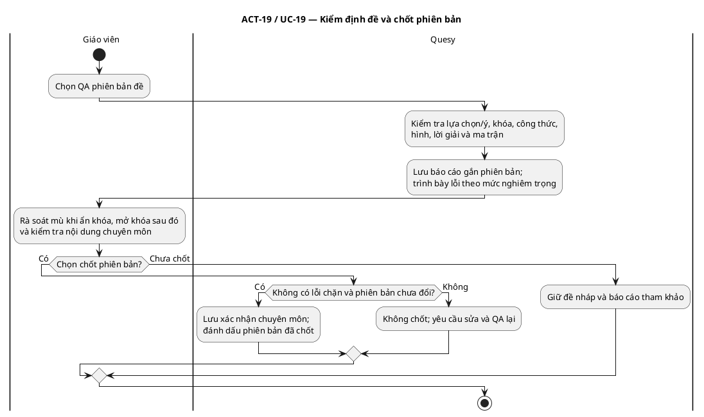


<a id="act-20"></a>
## ACT-20 — Sinh các mã đề hoán vị an toàn

Đối chiếu: [UC-20](08_MO_TA_USE_CASE.md#uc-20); quy tắc BR-02, BR-10, BR-13.

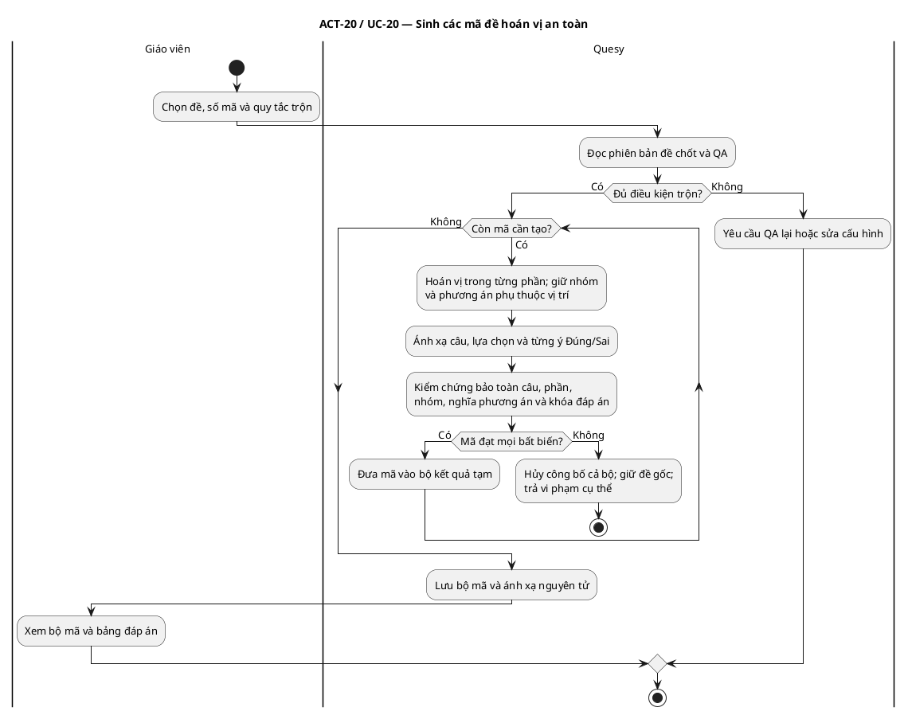


<a id="act-21"></a>
## ACT-21 — Xuất bản bộ ấn phẩm khảo thí

Đối chiếu: [UC-21](08_MO_TA_USE_CASE.md#uc-21); quy tắc BR-01, BR-02, BR-10, BR-12.

```plantuml
@startuml ACT_21
skinparam defaultFontName Segoe UI
skinparam shadowing false
skinparam defaultFontSize 13
title ACT-21 / UC-21 — Xuất bản bộ ấn phẩm khảo thí
|Giáo viên|
start
:Chọn bộ đề, mẫu và ấn phẩm;
|Quesy|
:Kiểm tra quyền, phiên bản,\nQA, ánh xạ và tài sản;
if (Đủ điều kiện?) then (Có)
  |Bộ biên dịch|
  :Biên dịch đề, đáp án và lời giải riêng;
  |Quesy|
  if (Biên dịch thành công?) then (Có)
    :Đối chiếu mã đề, phiên bản và tệp;\nkiểm tra không lẫn đáp án trong đề;
    if (Mọi ấn phẩm hợp lệ?) then (Có)
      :Tạo danh mục gói; lưu hoàn tất\nvà cấp liên kết tải theo quyền;
      |Giáo viên|
      :Tải ấn phẩm;
    else (Không)
      |Quesy|
      :Chặn công bố; nêu tệp sai;
    endif
  else (Không)
    :Giữ nháp; báo mã đề và vị trí lỗi;
  endif
else (Không)
  :Không xuất bản; nêu điều kiện thiếu;
endif
stop
@enduml
```


<a id="act-22"></a>
## ACT-22 — Quản lý danh sách lớp và kỳ chấm

Đối chiếu: [UC-22](08_MO_TA_USE_CASE.md#uc-22); quy tắc BR-01, BR-07, BR-14.

```plantuml
@startuml ACT_22
skinparam defaultFontName Segoe UI
skinparam shadowing false
skinparam defaultFontSize 13
title ACT-22 / UC-22 — Quản lý danh sách lớp và kỳ chấm
|Giáo viên|
start
|Giáo viên|
:Nhập trực tiếp hoặc tải danh sách theo mẫu;
|Quesy|
:Kiểm tra cột, mã trùng và phạm vi lớp;
|Quesy|
if (Mã học sinh và tham chiếu đề hợp lệ?) then (Có)
else (Không)
  :Điều kiện chưa đạt; nêu lỗi cụ thể, giữ dữ liệu đã lưu\nvà không chốt thay đổi;
  stop
endif
|Giáo viên|
:Đối chiếu bản xem trước và chọn đề cho kỳ chấm;
|Quesy|
:Lưu lớp, danh sách và kỳ chấm gắn phiên bản đề;
stop
@enduml
```


<a id="act-23"></a>
## ACT-23 — Nhập bài và chấm theo đúng mã đề

Đối chiếu: [UC-23](08_MO_TA_USE_CASE.md#uc-23); quy tắc BR-10, BR-13, BR-14.

```plantuml
@startuml ACT_23
skinparam defaultFontName Segoe UI
skinparam shadowing false
skinparam defaultFontSize 13
title ACT-23 / UC-23 — Nhập bài và chấm theo đúng mã đề
|Giáo viên|
start
:Chọn kỳ chấm và nhập bài/phiếu;
|Quesy|
if (Nguồn là ảnh phiếu?) then (Có)
  :Nhận dạng ô; đánh dấu ô mơ hồ;
else (Nhập tay / bảng dữ liệu)
  :Đọc câu trả lời theo mẫu;
endif
:Đối chiếu học sinh, mã đề\nvà hồ sơ chấm đã ghim;
|Giáo viên|
:Xác minh ô mờ/đa tô, mã đề\nvà điểm tự luận theo rubric;
|Quesy|
if (Mã xác định và hết dữ liệu mơ hồ?) then (Có)
  :Tính MCQ theo khóa, Đúng/Sai theo số ý khớp,\ntrả lời ngắn sau chuẩn hóa thập phân;\nghép điểm tự luận giáo viên nhập;
  :Trả điểm thành phần để rà soát;
  |Giáo viên|
  if (Xác nhận chốt?) then (Có)
    |Quesy|
    :Lưu bài, điểm, mã đề,\nhồ sơ và lịch sử nguyên tử;
  else (Chưa chốt)
    |Quesy|
    :Giữ nháp kết quả;
  endif
else (Không)
  :Giữ bài chờ xác minh;\nkhông công bố điểm;
endif
stop
@enduml
```


<a id="act-24"></a>
## ACT-24 — Phân tích kết quả và chất lượng câu hỏi

Đối chiếu: [UC-24](08_MO_TA_USE_CASE.md#uc-24); quy tắc BR-01, BR-10, BR-15.

```plantuml
@startuml ACT_24
skinparam defaultFontName Segoe UI
skinparam shadowing false
skinparam defaultFontSize 13
title ACT-24 / UC-24 — Phân tích kết quả và chất lượng câu hỏi
|Giáo viên|
start
|Giáo viên|
:Chọn kỳ chấm và tập kết quả;
|Quesy|
:Lấy kết quả có quyền; ánh xạ mọi mã về câu gốc;
|Quesy|
if (Kỳ chấm và tập kết quả thuộc quyền?) then (Có)
else (Không)
  :Điều kiện chưa đạt; nêu lỗi cụ thể, giữ dữ liệu đã lưu\nvà không chốt thay đổi;
  stop
endif
|Quesy|
:Tổng hợp phổ điểm và tính chỉ số trên mẫu hợp lệ;
|Quesy|
:Hiển thị số mẫu, dữ liệu thiếu và cảnh báo diễn giải;
|Giáo viên|
:Xem hoặc xuất báo cáo để điều chỉnh kho;
stop
@enduml
```


<a id="act-25"></a>
## ACT-25 — Quản lý tài khoản và quyền truy cập

Đối chiếu: [UC-25](08_MO_TA_USE_CASE.md#uc-25); quy tắc BR-01, BR-14, BR-16.

```plantuml
@startuml ACT_25
skinparam defaultFontName Segoe UI
skinparam shadowing false
skinparam defaultFontSize 13
title ACT-25 / UC-25 — Quản lý tài khoản và quyền truy cập
|Quản trị viên kỹ thuật|
start
|Quản trị viên kỹ thuật|
:Tra cứu tài khoản và chọn thay đổi quyền/trạng thái;
|Quesy|
:Kiểm tra quyền quản trị, phiên bản và bảo vệ quản trị\nviên hoạt động cuối cùng;
|Quesy|
if (Có quyền và không vô hiệu quản trị viên cuối?) then (Có)
else (Không)
  :Điều kiện chưa đạt; nêu lỗi cụ thể, giữ dữ liệu đã lưu\nvà không chốt thay đổi;
  stop
endif
|Quản trị viên kỹ thuật|
:Xem tác động và xác nhận lý do;
|Quesy|
:Cập nhật, thu hồi phiên bị ảnh hưởng và ghi nhật ký;
|Quesy|
:Thông báo kết quả quản trị;
stop
@enduml
```


<a id="act-26"></a>
## ACT-26 — Quản lý danh mục kiến thức dùng chung

Đối chiếu: [UC-26](08_MO_TA_USE_CASE.md#uc-26); quy tắc BR-02, BR-03, BR-16.

```plantuml
@startuml ACT_26
skinparam defaultFontName Segoe UI
skinparam shadowing false
skinparam defaultFontSize 13
title ACT-26 / UC-26 — Quản lý danh mục kiến thức dùng chung
|Quản trị viên kỹ thuật|
start
|Quản trị viên kỹ thuật|
:Soạn bản sửa danh mục chung và khai báo nguồn;
|Quesy|
:Kiểm tra cây, mã trùng, nguồn và tác động tham chiếu;
|Quesy|
if (Cây, mã và nguồn tham chiếu hợp lệ?) then (Có)
else (Không)
  :Điều kiện chưa đạt; nêu lỗi cụ thể, giữ dữ liệu đã lưu\nvà không chốt thay đổi;
  stop
endif
|Quản trị viên kỹ thuật|
:Xem khác biệt và xác nhận công bố;
|Quesy|
:Phát hành phiên bản danh mục mới; giữ phiên bản cũ;
stop
@enduml
```


<a id="act-27"></a>
## ACT-27 — Quản lý hồ sơ đề và quy tắc chấm

Đối chiếu: [UC-27](08_MO_TA_USE_CASE.md#uc-27); quy tắc BR-02, BR-13, BR-16.

```plantuml
@startuml ACT_27
skinparam defaultFontName Segoe UI
skinparam shadowing false
skinparam defaultFontSize 13
title ACT-27 / UC-27 — Quản lý hồ sơ đề và quy tắc chấm
|Quản trị viên kỹ thuật|
start
|Quản trị viên kỹ thuật|
:Soạn hồ sơ cấu trúc và quy tắc chấm;
|Quesy|
:Kiểm tra tổng điểm và các ca mẫu, gồm 0..4 ý Đúng/Sai;
|Quesy|
if (Quy tắc và mọi ca mẫu đều hợp lệ?) then (Có)
else (Không)
  :Điều kiện chưa đạt; nêu lỗi cụ thể, giữ dữ liệu đã lưu\nvà không chốt thay đổi;
  stop
endif
|Quản trị viên kỹ thuật|
:Đối chiếu nguồn nghiệp vụ và xác nhận công bố;
|Quesy|
:Lưu phiên bản hồ sơ và nhật ký; không áp dụng ngược vào\nđề cũ;
stop
@enduml
```


<a id="act-28"></a>
## ACT-28 — Cấu hình dịch vụ AI và biên dịch

Đối chiếu: [UC-28](08_MO_TA_USE_CASE.md#uc-28); quy tắc BR-08, BR-14, BR-16.

```plantuml
@startuml ACT_28
skinparam defaultFontName Segoe UI
skinparam shadowing false
skinparam defaultFontSize 13
title ACT-28 / UC-28 — Cấu hình dịch vụ AI và biên dịch
|Quản trị viên kỹ thuật|
start
|Quản trị viên kỹ thuật|
:Nhập cấu hình và chính sách dữ liệu;
|Quesy|
:Kiểm tra trường, địa chỉ dịch vụ và lưu bí mật được bảo\nvệ;
|Quesy|
:Thử kết nối bằng tài liệu mẫu không chứa dữ liệu riêng;
|Quesy|
if (Thử kết nối bằng dữ liệu mẫu thành công?) then (Có)
else (Không)
  :Điều kiện chưa đạt; nêu lỗi cụ thể, giữ dữ liệu đã lưu\nvà không chốt thay đổi;
  stop
endif
|Quản trị viên kỹ thuật|
:Xem kết quả thử và xác nhận kích hoạt;
|Quesy|
:Kích hoạt phiên bản mới; giữ khả năng quay về bản trước;
stop
@enduml
```


<a id="act-29"></a>
## ACT-29 — Giám sát tác vụ, nhật ký và xử lý lỗi

Đối chiếu: [UC-29](08_MO_TA_USE_CASE.md#uc-29); quy tắc BR-07, BR-14, BR-16.

```plantuml
@startuml ACT_29
skinparam defaultFontName Segoe UI
skinparam shadowing false
skinparam defaultFontSize 13
title ACT-29 / UC-29 — Giám sát tác vụ, nhật ký và xử lý lỗi
|Quản trị viên kỹ thuật|
start
|Quản trị viên kỹ thuật|
:Tra cứu lỗi và tiến độ theo mã tác vụ;
|Quesy|
:Trả trạng thái và thông tin chẩn đoán đã che dữ liệu\nriêng;
|Quản trị viên kỹ thuật|
:Chọn hủy hoặc thử lại phần lỗi khi được phép;
|Quesy|
if (Lệnh hợp lệ với trạng thái tác vụ hiện tại?) then (Có)
else (Không)
  :Điều kiện chưa đạt; nêu lỗi cụ thể, giữ dữ liệu đã lưu\nvà không chốt thay đổi;
  stop
endif
|Quesy|
:Kiểm tra trạng thái và khóa chống lặp; ghi lệnh điều\nkhiển;
|Quesy|
:Trả trạng thái sau xử lý, giữ lịch sử lần chạy;
stop
@enduml
```


<a id="act-30"></a>
## ACT-30 — Sao lưu và khôi phục hệ thống

Đối chiếu: [UC-30](08_MO_TA_USE_CASE.md#uc-30); quy tắc BR-02, BR-14, BR-16.

```plantuml
@startuml ACT_30
skinparam defaultFontName Segoe UI
skinparam shadowing false
skinparam defaultFontSize 13
title ACT-30 / UC-30 — Sao lưu và khôi phục hệ thống
|Quản trị viên kỹ thuật|
start
:Chọn sao lưu hoặc phục hồi và phạm vi;
|Quesy|
:Kiểm tra quyền và điều kiện bảo trì;
if (Đủ quyền và điều kiện?) then (Có)
  if (Chọn phục hồi?) then (Có)
    :Giữ điểm quay lui; đọc bản sao\nvào vùng kiểm tra riêng;
    :Đối chiếu dữ liệu, tài sản,\nmã kiểm tra và tương thích;
    if (Đối soát đạt?) then (Có)
      |Quản trị viên kỹ thuật|
      :Xem báo cáo; xác minh tăng cường;
      if (Xác nhận chuyển hoạt động?) then (Có)
        |Quesy|
        :Chuyển trong cửa sổ bảo trì;
        if (Chuyển thành công?) then (Có)
          :Ghi trạng thái phục hồi hoàn tất;
        else (Không)
          :Quay về điểm trước phục hồi;\nghi sự cố và kết quả quay lui;
        endif
      else (Hủy)
        |Quesy|
        :Giữ dữ liệu hoạt động;
      endif
    else (Không)
      :Không chuyển; báo bản sao không hợp lệ;
    endif
  else (Sao lưu)
    :Chụp nhất quán dữ liệu và tài sản;
    |Kho sao lưu|
    :Ghi bản sao được bảo vệ và mã kiểm tra;
    |Quesy|
    :Đối soát lại bản sao;
    if (Bản sao toàn vẹn?) then (Có)
      :Ghi danh mục bản sao hợp lệ;
    else (Không)
      :Đánh dấu bản sao lỗi;
    endif
  endif
  :Ghi nhật ký thao tác và kết quả;
else (Không)
  :Từ chối; không đổi dữ liệu hoạt động;
endif
stop
@enduml
```
