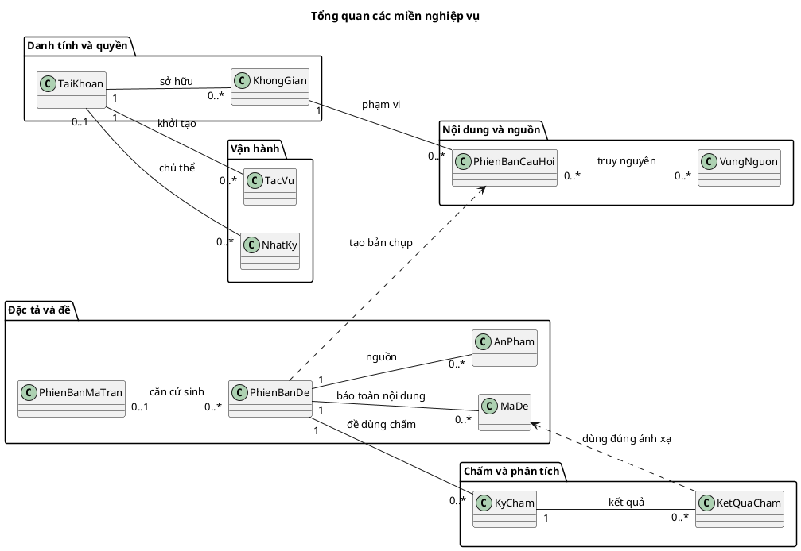
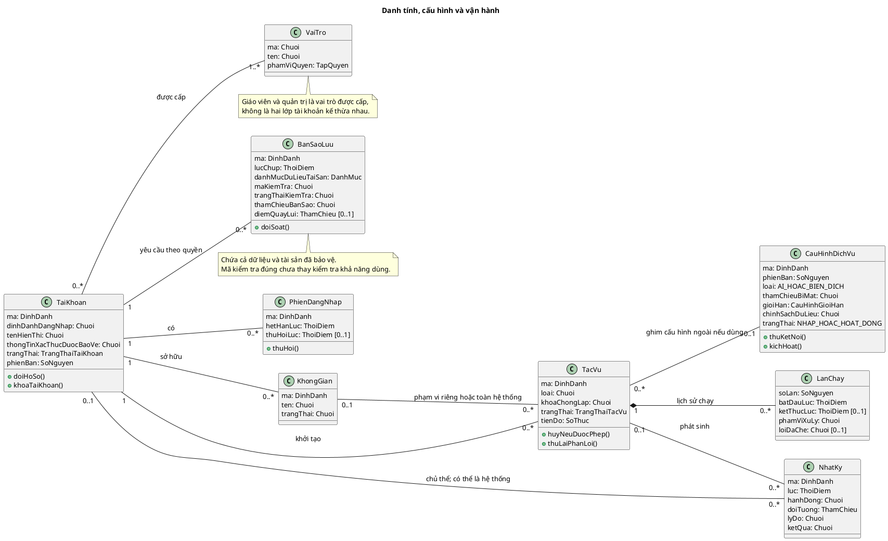
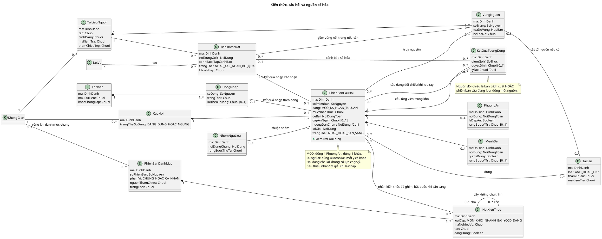
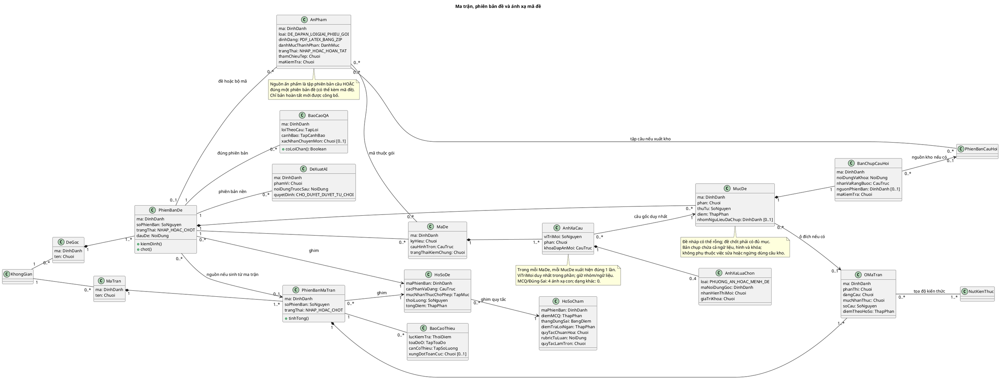
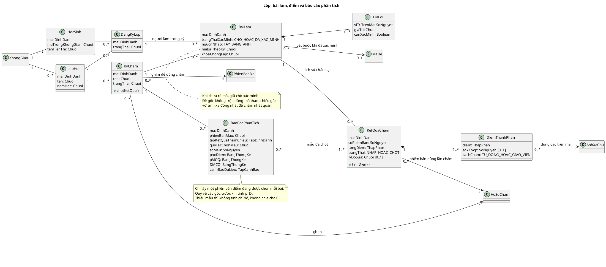

# Sơ đồ lớp phân tích

> Quesy · Bản phân tích nghiệp vụ 1.0 · Ngày 17/11/2026
> Trạng thái: bản đặc tả đề xuất, không phải báo cáo chức năng đã triển khai.

## Mục đích và mức trừu tượng

Đây là **Class Diagram phân tích miền nghiệp vụ**, suy ra từ dữ liệu và quy tắc trong các Use Case. Không phải sơ đồ bảng dữ liệu hay bản sao lớp trong mã. Thuộc tính kiểu `Chuoi`, `NoiDung`, `CauTruc` là kiểu khái niệm; chỉ thể hiện thông tin cần tồn tại, chưa quy định công nghệ lưu trữ. Các phương thức biểu diễn trách nhiệm nghiệp vụ tiêu biểu.

Đường có bội số chỉ quan hệ có thể kiểm tra; hình thoi đặc là vòng đời thành phần thuộc toàn thể, không là lệnh xóa vật lý. Chính sách lưu phiên bản và tham chiếu lịch sử vẫn áp dụng. Mỗi sơ đồ tự chứa các lớp tham chiếu để đọc độc lập; lớp lặp tên là cùng khái niệm, không là thực thể thứ hai.

## Bất biến mô hình

| Mã | Ràng buộc |
|---|---|
| CL-01 | Một không gian có một tài khoản sở hữu; quyền quản trị không tạo quan hệ sở hữu kho khác. Tài khoản có thể có cả hai vai trò nhưng quyền được xét theo phạm vi. |
| CL-02 | Cây không có chu trình; mã con duy nhất theo phạm vi/phiên bản đã quy định. Khối và môn là hai chiều gốc liên quan, nhánh kiến thức nằm dưới tổ hợp môn–khối; không bắt buộc bảy cấp vật lý cố định. |
| CL-03 | Phiên bản câu sẵn sàng thỏa BR-04; 0..4 phương án/ý trong sơ đồ chỉ là biên tổng quát, ràng buộc đúng 4 áp dụng theo dạng. Mức nhận thức và dạng câu không là hai cấp con bắt buộc trong cây. |
| CL-04 | Câu số hóa có trang/vùng và tài liệu nguồn; câu nhập tay có thể không có vùng nguồn. Một câu kéo qua nhiều trang được gắn nhiều vùng. |
| CL-05 | Một phiên bản đề ghim hồ sơ và giữ bản chụp từng mục. Thay nhãn, hình hoặc đáp án ở kho không sửa bản chụp cũ. Đề soạn tay có thể chưa liên kết ma trận. |
| CL-06 | Mỗi mã đề chứa song ánh tới toàn bộ mục đề gốc; ràng buộc duy nhất vị trí trong phần và thứ tự nhóm được kiểm chứng trước lưu. Hồ sơ chấm và khóa tương ứng đúng phiên bản. |
| CL-07 | Chấm đề gốc không trộn dùng mã tham chiếu gốc và ánh xạ đồng nhất, tránh hai cách diễn giải khóa khác nhau. Mỗi điểm thành phần tham chiếu đúng câu theo mã. |
| CL-08 | Nghiệp vụ chấm lại thêm phiên bản kết quả; báo cáo phân tích chọn rõ phiên bản, không đếm hai lần cùng một bài. |
| CL-09 | Tác vụ, cấu hình và bản sao có nguồn/phạm vi, trạng thái và nhật ký. Thử lại cùng khóa không tạo bản ghi nghiệp vụ lặp. |

## Tổng quan các miền nghiệp vụ

## Danh tính, cấu hình và vận hành

## Kiến thức, câu hỏi và nguồn số hóa

## Ma trận, phiên bản đề và ánh xạ mã đề

## Lớp, bài làm, điểm và báo cáo phân tích

## Từ vựng dữ liệu xuyên suốt

`DinhDanh` là mã ổn định; `PhienBan` cho phép xác định nội dung tại một thời điểm; `BanChupCauHoi` giữ nội dung thật sự dùng trong đề; `AnhXaCau`/`AnhXaLuaChon` giữ liên hệ từ mã đề về nội dung gốc. Các tên trong Sequence như “Quản lý ngân hàng câu hỏi” là dịch vụ trách nhiệm logic, không phải actor ngoài hoặc bảng dữ liệu. M01/M03 cung cấp phương pháp tìm công việc và dữ liệu; các lớp, bội số và bất biến trên là kết quả phân tích đề xuất cho Quesy.
