# Sơ đồ tuần tự từng chức năng

> Quesy · Bản phân tích nghiệp vụ 1.0 · Ngày 17/11/2026
> Trạng thái: bản đặc tả đề xuất, không phải báo cáo chức năng đã triển khai.

## Quy ước và mức thiết kế

SEQ-nn tương ứng UC-nn và ACT-nn. `A` là tác nhân khởi tạo, `UI` là giao diện Quesy, `S` là trách nhiệm điều phối nghiệp vụ logic, `D` là kho dữ liệu Quesy, `E` là dịch vụ ngoài khi có. Lifeline là đối tượng cộng tác phân tích, không mô tả cấu trúc lớp mã nguồn hay khẳng định có một máy chủ riêng cho mỗi đối tượng.

Mũi tên liền là thông điệp/yêu cầu; mũi tên đứt là kết quả. `alt/else` là lựa chọn loại trừ, `opt` là phần có điều kiện, `loop` là lặp, `ref` là tham chiếu một Use Case đã đặc tả. Tác vụ số hóa trả tiếp nhận trước và cho xem tiến độ sau; thông điệp được diễn đạt ở mức nghiệp vụ, chưa chốt HTTP hay giao thức hàng đợi. Ghi dữ liệu được mô tả thành công giả định giao dịch đạt; lỗi lưu phải giữ các bảo đảm của UC và NFR-04.


<a id="seq-01"></a>
## SEQ-01 — Đăng ký tài khoản giáo viên

Đối chiếu: [UC-01](08_MO_TA_USE_CASE.md#uc-01); dữ liệu TaiKhoan, KhongGian.

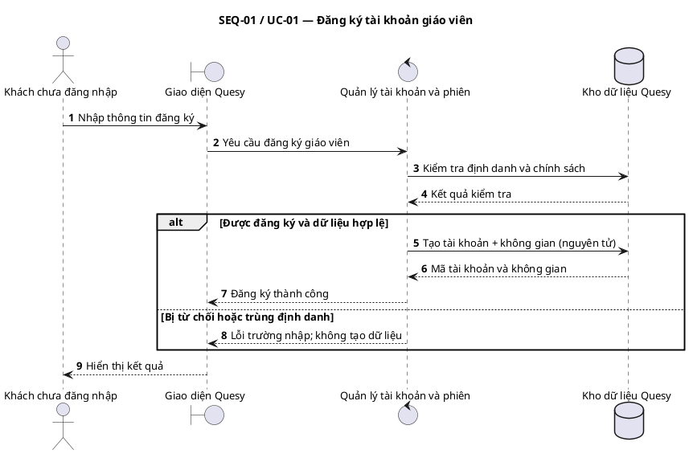


<a id="seq-02"></a>
## SEQ-02 — Đăng nhập

Đối chiếu: [UC-02](08_MO_TA_USE_CASE.md#uc-02); dữ liệu TaiKhoan, PhienDangNhap.

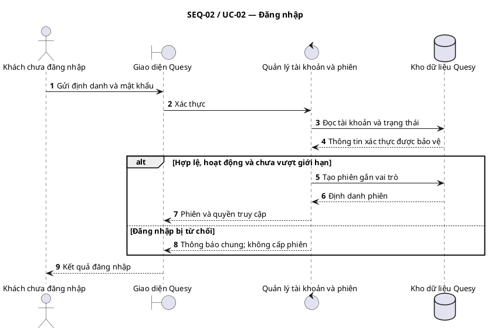


<a id="seq-03"></a>
## SEQ-03 — Đăng xuất

Đối chiếu: [UC-03](08_MO_TA_USE_CASE.md#uc-03); dữ liệu PhienDangNhap.

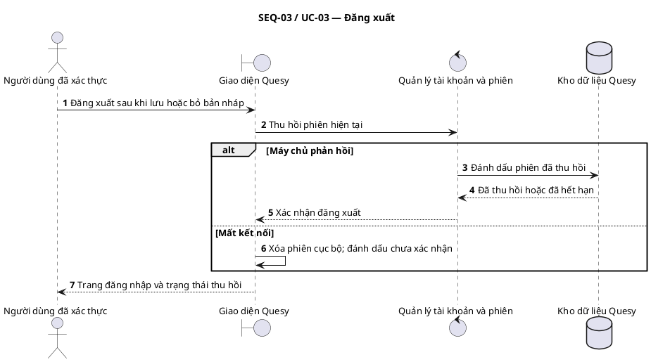


<a id="seq-04"></a>
## SEQ-04 — Cập nhật hồ sơ và đổi mật khẩu

Đối chiếu: [UC-04](08_MO_TA_USE_CASE.md#uc-04); dữ liệu TaiKhoan, PhienDangNhap.

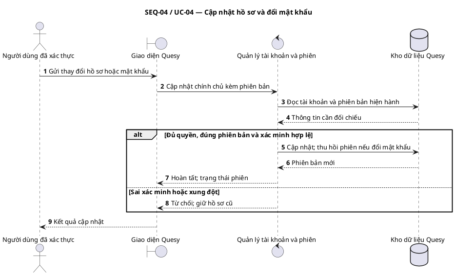


<a id="seq-05"></a>
## SEQ-05 — Tổ chức cây kiến thức cá nhân

Đối chiếu: [UC-05](08_MO_TA_USE_CASE.md#uc-05); dữ liệu NutKienThuc, KhongGian.

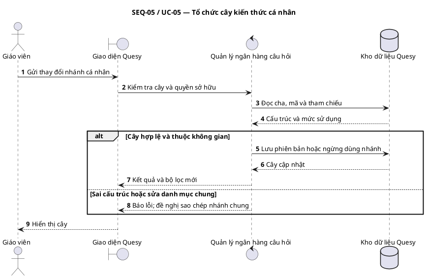


<a id="seq-06"></a>
## SEQ-06 — Tra cứu và xem câu hỏi

Đối chiếu: [UC-06](08_MO_TA_USE_CASE.md#uc-06); dữ liệu CauHoi, PhienBanCauHoi, TaiSan.

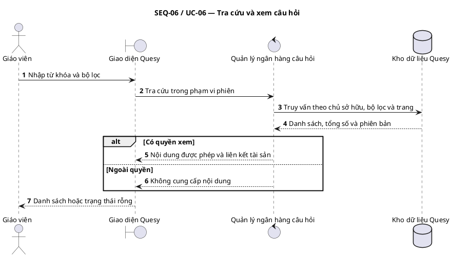


<a id="seq-07"></a>
## SEQ-07 — Tạo và chỉnh sửa câu hỏi

Đối chiếu: [UC-07](08_MO_TA_USE_CASE.md#uc-07); dữ liệu CauHoi, PhienBanCauHoi, PhuongAn, MenhDe, KetQuaTuongDong.

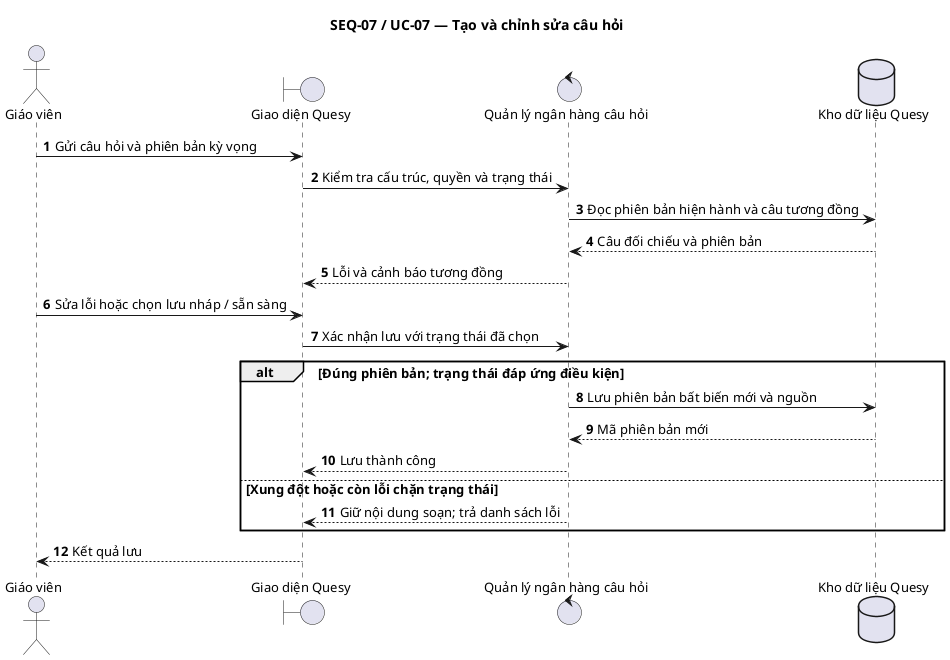


<a id="seq-08"></a>
## SEQ-08 — Ngừng dùng và khôi phục câu hỏi

Đối chiếu: [UC-08](08_MO_TA_USE_CASE.md#uc-08); dữ liệu CauHoi, PhienBanCauHoi, NhatKy.

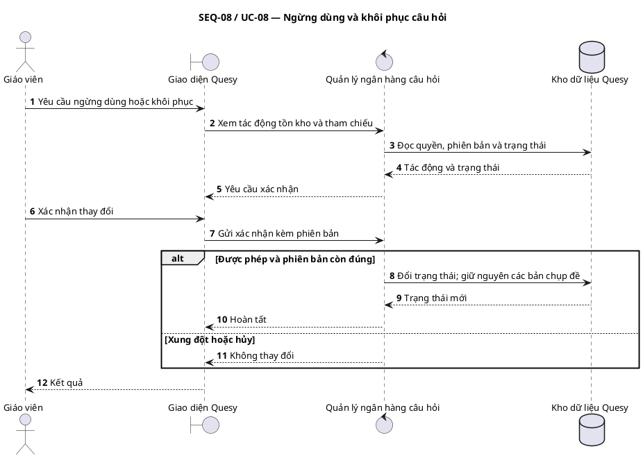


<a id="seq-09"></a>
## SEQ-09 — Nhập ngân hàng từ dữ liệu có cấu trúc

Đối chiếu: [UC-09](08_MO_TA_USE_CASE.md#uc-09); dữ liệu LoNhap, DongNhap, PhienBanCauHoi.

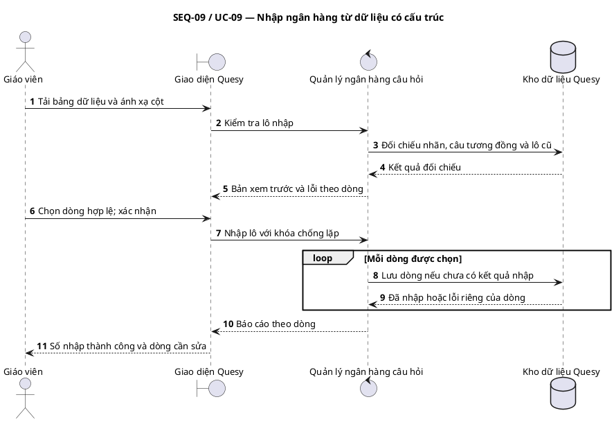


<a id="seq-10"></a>
## SEQ-10 — Xuất tập câu hỏi ngân hàng

Đối chiếu: [UC-10](08_MO_TA_USE_CASE.md#uc-10); dữ liệu PhienBanCauHoi, AnPham, TacVu.

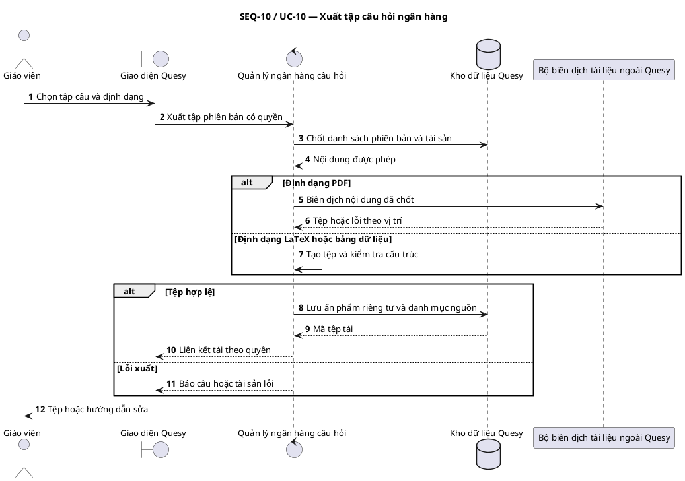


<a id="seq-11"></a>
## SEQ-11 — Số hóa tài liệu nguồn bằng AI

Đối chiếu: [UC-11](08_MO_TA_USE_CASE.md#uc-11); dữ liệu TaiLieuNguon, VungNguon, TaiSan, TacVu, BanTrichXuat.

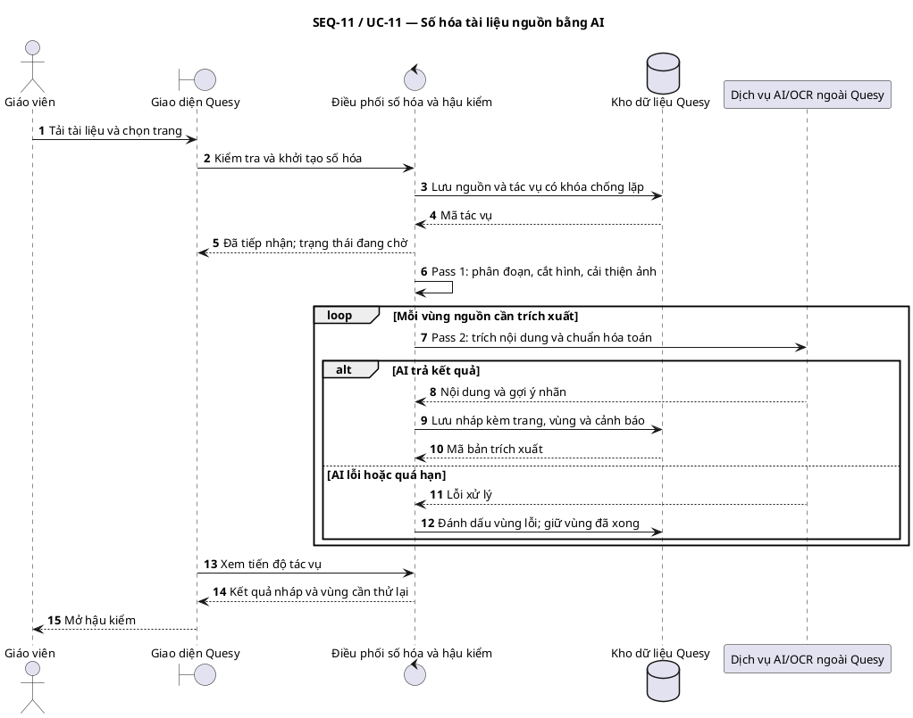


<a id="seq-12"></a>
## SEQ-12 — Hậu kiểm và đưa câu số hóa vào kho

Đối chiếu: [UC-12](08_MO_TA_USE_CASE.md#uc-12); dữ liệu BanTrichXuat, VungNguon, PhienBanCauHoi.

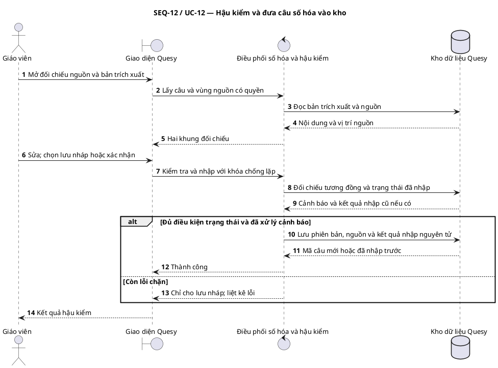


<a id="seq-13"></a>
## SEQ-13 — Thiết lập ma trận đặc tả

Đối chiếu: [UC-13](08_MO_TA_USE_CASE.md#uc-13); dữ liệu MaTran, PhienBanMaTran, OMaTran, HoSoDe.

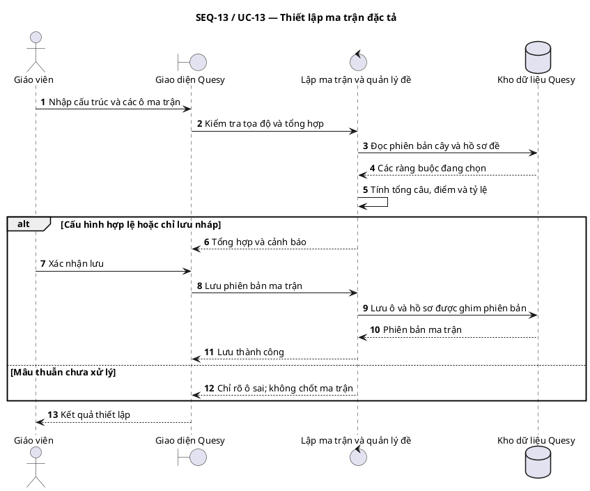


<a id="seq-14"></a>
## SEQ-14 — Kiểm tra khả năng đáp ứng ma trận

Đối chiếu: [UC-14](08_MO_TA_USE_CASE.md#uc-14); dữ liệu OMaTran, PhienBanCauHoi, BaoCaoThieu.

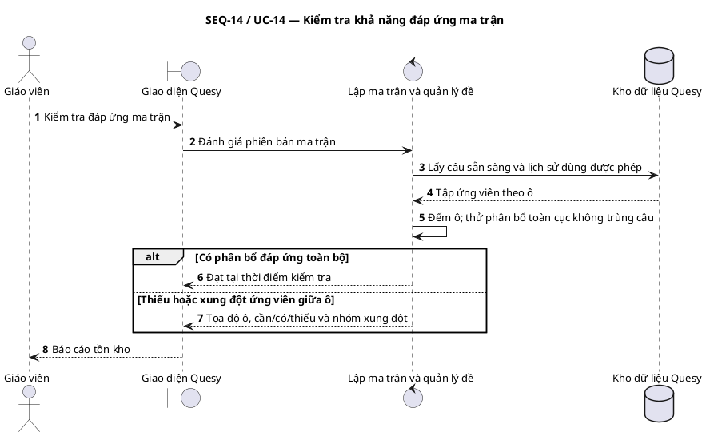


<a id="seq-15"></a>
## SEQ-15 — Sinh đề gốc theo ma trận

Đối chiếu: [UC-15](08_MO_TA_USE_CASE.md#uc-15); dữ liệu DeGoc, PhienBanDe, MucDe, BanChupCauHoi, PhienBanMaTran.

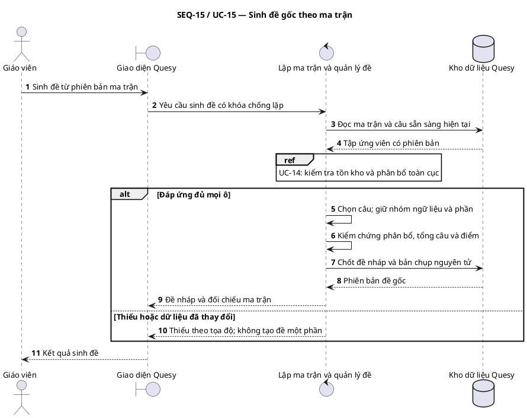


<a id="seq-16"></a>
## SEQ-16 — Biên soạn và xem trước đề

Đối chiếu: [UC-16](08_MO_TA_USE_CASE.md#uc-16); dữ liệu PhienBanDe, MucDe, TaiSan.

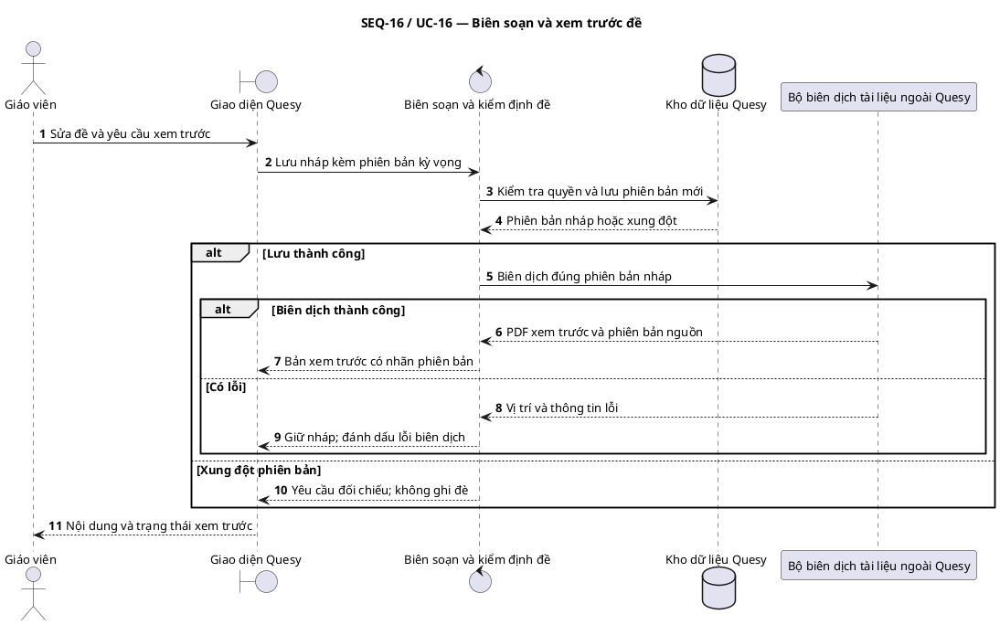


<a id="seq-17"></a>
## SEQ-17 — Nhận và duyệt đề xuất của Copilot

Đối chiếu: [UC-17](08_MO_TA_USE_CASE.md#uc-17); dữ liệu DeXuatAI, PhienBanDe, TacVu.

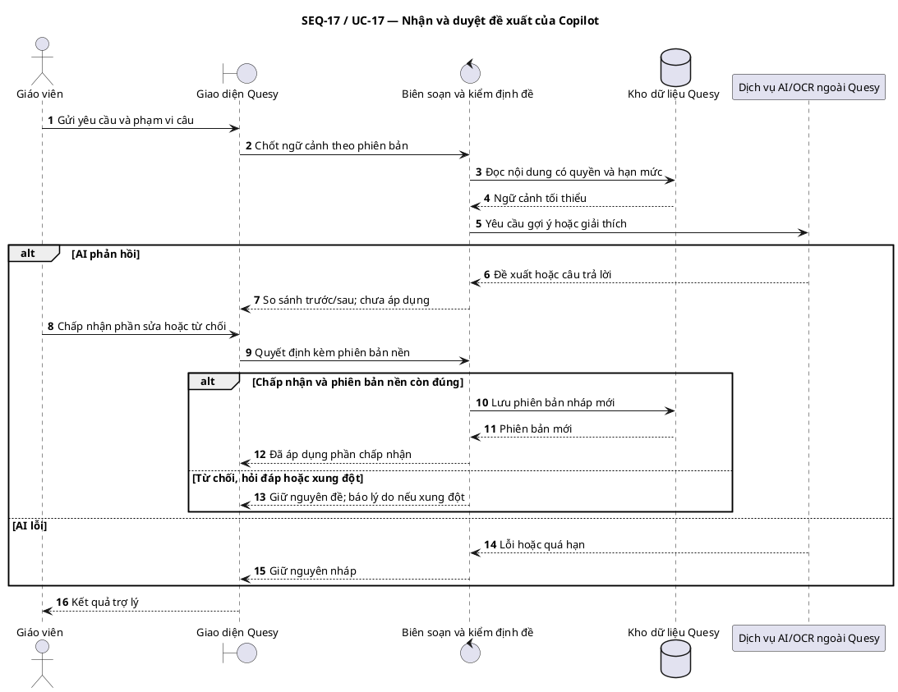


<a id="seq-18"></a>
## SEQ-18 — Thay câu bằng đối chiếu song song

Đối chiếu: [UC-18](08_MO_TA_USE_CASE.md#uc-18); dữ liệu PhienBanDe, MucDe, BanChupCauHoi, DeXuatAI.

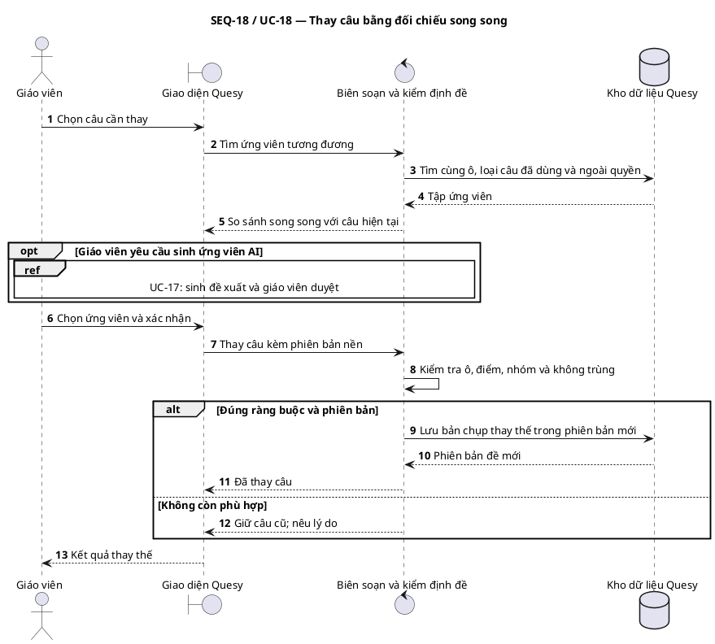


<a id="seq-19"></a>
## SEQ-19 — Kiểm định đề và chốt phiên bản

Đối chiếu: [UC-19](08_MO_TA_USE_CASE.md#uc-19); dữ liệu BaoCaoQA, PhienBanDe.

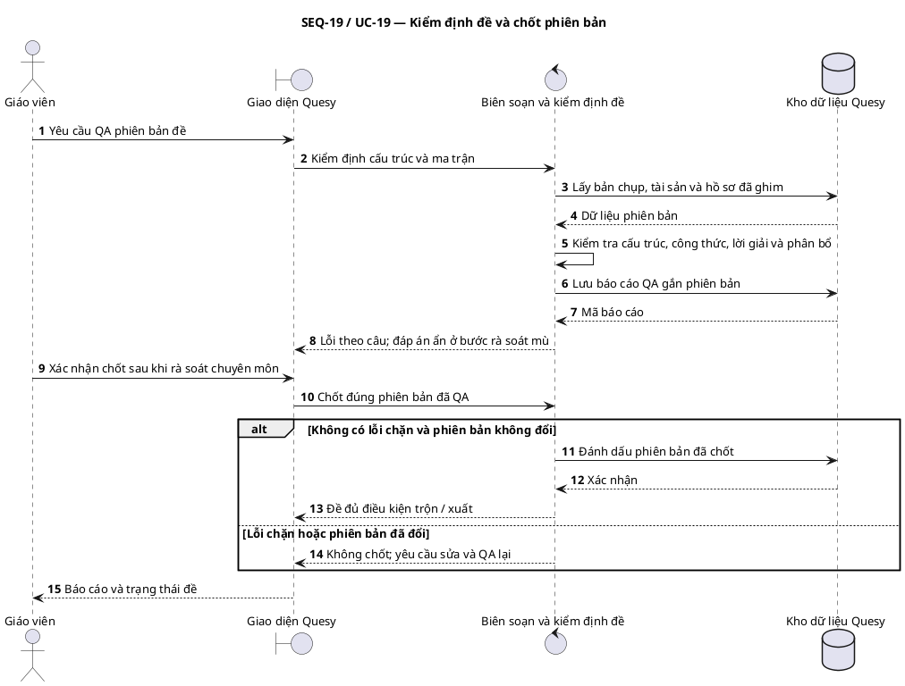


<a id="seq-20"></a>
## SEQ-20 — Sinh các mã đề hoán vị an toàn

Đối chiếu: [UC-20](08_MO_TA_USE_CASE.md#uc-20); dữ liệu PhienBanDe, MaDe, AnhXaCau, AnhXaLuaChon.

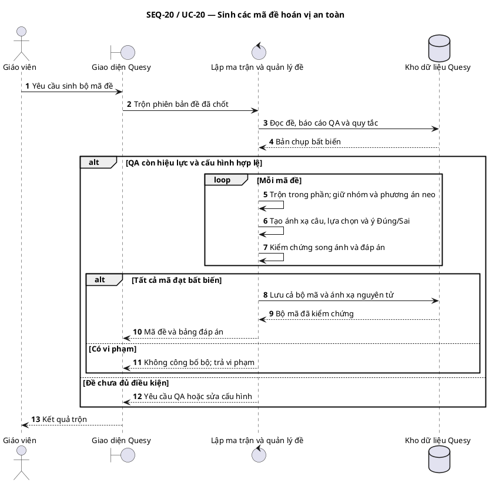


<a id="seq-21"></a>
## SEQ-21 — Xuất bản bộ ấn phẩm khảo thí

Đối chiếu: [UC-21](08_MO_TA_USE_CASE.md#uc-21); dữ liệu AnPham, PhienBanDe, MaDe, HoSoDe, TacVu.

```plantuml
@startuml SEQ_21
skinparam defaultFontName Segoe UI
skinparam shadowing false
skinparam defaultFontSize 13
title SEQ-21 / UC-21 — Xuất bản bộ ấn phẩm khảo thí
actor "Giáo viên" as A
boundary "Giao diện Quesy" as UI
control "Xuất bản ấn phẩm" as S
database "Kho dữ liệu Quesy" as D
participant "Bộ biên dịch tài liệu ngoài Quesy" as E
autonumber
A -> UI: Chọn đề, mã và loại ấn phẩm
UI -> S: Xuất bản đúng phiên bản đã chốt
S -> D: Đọc QA, ánh xạ và tài sản
D --> S: Bộ dữ liệu đã kiểm chứng
S -> E: Biên dịch đề / đáp án / lời giải riêng
alt Biên dịch thành công
  E --> S: Các tệp cùng mã đề và phiên bản
  S -> S: Kiểm tra tệp, tách đáp án và lập danh mục gói
  alt Mọi ấn phẩm hợp lệ
    S -> D: Lưu gói hoàn tất và phạm vi tải
    D --> S: Mã gói tải riêng tư
    S --> UI: Tệp và danh mục phiên bản
  else Sai mã hoặc lẫn đáp án
    S --> UI: Chặn công bố; báo tệp lỗi
  end
else Có lỗi biên dịch
  E --> S: Lỗi theo câu hoặc mã đề
  S --> UI: Chưa hoàn tất; hướng dẫn sửa
end
UI --> A: Kết quả xuất bản
@enduml
```


<a id="seq-22"></a>
## SEQ-22 — Quản lý danh sách lớp và kỳ chấm

Đối chiếu: [UC-22](08_MO_TA_USE_CASE.md#uc-22); dữ liệu LopHoc, HocSinh, DangKyLop, KyCham.

```plantuml
@startuml SEQ_22
skinparam defaultFontName Segoe UI
skinparam shadowing false
skinparam defaultFontSize 13
title SEQ-22 / UC-22 — Quản lý danh sách lớp và kỳ chấm
actor "Giáo viên" as A
boundary "Giao diện Quesy" as UI
control "Chấm và phân tích" as S
database "Kho dữ liệu Quesy" as D
autonumber
A -> UI: Nhập danh sách lớp và chọn bộ đề
UI -> S: Kiểm tra danh sách
S -> D: Đối chiếu mã trong lớp và phiên bản đề
D --> S: Trùng lặp và tham chiếu điểm
alt Danh sách hợp lệ
  S --> UI: Bản xem trước
  A -> UI: Xác nhận danh sách và kỳ chấm
  UI -> S: Lưu cấu hình kỳ chấm
  S -> D: Lưu lớp, học sinh, đăng ký và kỳ chấm
  D --> S: Mã kỳ chấm
  S --> UI: Hoàn tất
else Có dòng lỗi
  S --> UI: Báo từng dòng; chưa nhập
end
UI --> A: Danh sách và kỳ chấm
@enduml
```


<a id="seq-23"></a>
## SEQ-23 — Nhập bài và chấm theo đúng mã đề

Đối chiếu: [UC-23](08_MO_TA_USE_CASE.md#uc-23); dữ liệu BaiLam, TraLoi, KetQuaCham, DiemThanhPhan, KyCham, HoSoCham.

```plantuml
@startuml SEQ_23
skinparam defaultFontName Segoe UI
skinparam shadowing false
skinparam defaultFontSize 13
title SEQ-23 / UC-23 — Nhập bài và chấm theo đúng mã đề
actor "Giáo viên" as A
boundary "Giao diện Quesy" as UI
control "Chấm và phân tích" as S
database "Kho dữ liệu Quesy" as D
autonumber
A -> UI: Nhập bài, ảnh phiếu và kỳ chấm
UI -> S: Tiếp nhận câu trả lời
opt Nguồn là ảnh phiếu
  S -> S: Nhận dạng ô và đánh dấu mơ hồ
end
S -> D: Lấy danh sách, đúng mã đề và hồ sơ chấm đã ghim
D --> S: Ánh xạ đáp án và học sinh
S --> UI: Các ô cần xác minh
A -> UI: Sửa ô mờ; xác nhận mã và điểm tự luận
UI -> S: Yêu cầu tính điểm
alt Mã đề xác định và hết dữ liệu mơ hồ
  S -> S: Tính điểm theo hồ sơ và từng dạng câu
  S --> UI: Điểm thành phần để rà soát
  A -> UI: Chốt kết quả
  UI -> S: Lưu kết quả kèm phiên bản
  S -> D: Lưu bài, điểm và lịch sử nguyên tử
  D --> S: Phiên bản kết quả
  S --> UI: Kết quả đã chốt
else Thiếu mã hoặc còn ô chưa xác minh
  S --> UI: Giữ bài chờ; không công bố điểm
end
UI --> A: Kết quả hoặc yêu cầu xác minh
@enduml
```


<a id="seq-24"></a>
## SEQ-24 — Phân tích kết quả và chất lượng câu hỏi

Đối chiếu: [UC-24](08_MO_TA_USE_CASE.md#uc-24); dữ liệu KetQuaCham, BaoCaoPhanTich, AnhXaCau.

```plantuml
@startuml SEQ_24
skinparam defaultFontName Segoe UI
skinparam shadowing false
skinparam defaultFontSize 13
title SEQ-24 / UC-24 — Phân tích kết quả và chất lượng câu hỏi
actor "Giáo viên" as A
boundary "Giao diện Quesy" as UI
control "Chấm và phân tích" as S
database "Kho dữ liệu Quesy" as D
autonumber
A -> UI: Chọn kỳ chấm và mẫu phân tích
UI -> S: Tổng hợp kết quả có quyền
S -> D: Đọc điểm đã chốt và ánh xạ câu gốc
D --> S: Mẫu hợp lệ và phiên bản chấm
S -> S: Quy về câu gốc; tính phổ điểm và kích thước mẫu
alt Mẫu đủ theo quy tắc chỉ số
  S -> S: Tính p, D cho MCQ; tách các dạng còn lại
  S -> D: Lưu báo cáo và quy tắc chọn mẫu
  D --> S: Mã báo cáo
  S --> UI: Chỉ số, mẫu số và giới hạn diễn giải
else Không đủ dữ liệu
  S --> UI: Phổ điểm nếu có; chỉ số chưa xác định
end
UI --> A: Báo cáo hoặc thông báo thiếu mẫu
@enduml
```


<a id="seq-25"></a>
## SEQ-25 — Quản lý tài khoản và quyền truy cập

Đối chiếu: [UC-25](08_MO_TA_USE_CASE.md#uc-25); dữ liệu TaiKhoan, VaiTro, PhienDangNhap, NhatKy.

```plantuml
@startuml SEQ_25
skinparam defaultFontName Segoe UI
skinparam shadowing false
skinparam defaultFontSize 13
title SEQ-25 / UC-25 — Quản lý tài khoản và quyền truy cập
actor "Quản trị viên kỹ thuật" as A
boundary "Giao diện Quesy" as UI
control "Quản trị vận hành" as S
database "Kho dữ liệu Quesy" as D
autonumber
A -> UI: Chọn tài khoản và thay đổi quyền
UI -> S: Kiểm tra tác động quản trị
S -> D: Đọc vai trò, phiên bản và quản trị viên còn hoạt động
D --> S: Trạng thái và điều kiện bảo vệ
S --> UI: Bản xem trước tác động
A -> UI: Xác minh và xác nhận lý do
UI -> S: Áp dụng thay đổi
alt Đủ quyền và còn quản trị viên hoạt động
  S -> D: Cập nhật quyền; thu hồi phiên; ghi nhật ký
  D --> S: Hoàn tất
  S --> UI: Kết quả thay đổi
else Vi phạm điều kiện bảo vệ
  S --> UI: Từ chối; không thay đổi quyền
end
UI --> A: Kết quả quản trị
@enduml
```


<a id="seq-26"></a>
## SEQ-26 — Quản lý danh mục kiến thức dùng chung

Đối chiếu: [UC-26](08_MO_TA_USE_CASE.md#uc-26); dữ liệu PhienBanDanhMuc, NutKienThuc, NhatKy.

```plantuml
@startuml SEQ_26
skinparam defaultFontName Segoe UI
skinparam shadowing false
skinparam defaultFontSize 13
title SEQ-26 / UC-26 — Quản lý danh mục kiến thức dùng chung
actor "Quản trị viên kỹ thuật" as A
boundary "Giao diện Quesy" as UI
control "Quản trị vận hành" as S
database "Kho dữ liệu Quesy" as D
autonumber
A -> UI: Soạn bản danh mục chung và nguồn
UI -> S: Kiểm tra cấu trúc và tác động
S -> D: Đọc danh mục và tham chiếu hiện hành
D --> S: Cây, mã và số tham chiếu
S --> UI: Khác biệt và cảnh báo di chuyển nhãn
A -> UI: Xác nhận công bố
UI -> S: Phát hành phiên bản danh mục
alt Hợp lệ và có nguồn tham chiếu
  S -> D: Lưu phiên bản mới và nhật ký; giữ bản cũ
  D --> S: Mã phiên bản mới
  S --> UI: Đã công bố
else Thiếu nguồn hoặc sai cấu trúc
  S --> UI: Không công bố; chỉ rõ lỗi
end
UI --> A: Trạng thái danh mục
@enduml
```


<a id="seq-27"></a>
## SEQ-27 — Quản lý hồ sơ đề và quy tắc chấm

Đối chiếu: [UC-27](08_MO_TA_USE_CASE.md#uc-27); dữ liệu HoSoDe, HoSoCham, NhatKy.

```plantuml
@startuml SEQ_27
skinparam defaultFontName Segoe UI
skinparam shadowing false
skinparam defaultFontSize 13
title SEQ-27 / UC-27 — Quản lý hồ sơ đề và quy tắc chấm
actor "Quản trị viên kỹ thuật" as A
boundary "Giao diện Quesy" as UI
control "Quản trị vận hành" as S
database "Kho dữ liệu Quesy" as D
autonumber
A -> UI: Nhập hồ sơ cấu trúc và chấm
UI -> S: Kiểm tra quy tắc và ca mẫu
S -> S: Kiểm tra 0..4 ý đúng, dấu thập phân và tổng điểm
S --> UI: Kết quả ca mẫu và nguồn tham chiếu
A -> UI: Xác nhận phát hành
UI -> S: Công bố hồ sơ mới
alt Quy tắc nhất quán và ca mẫu đạt
  S -> D: Lưu phiên bản hồ sơ và nhật ký
  D --> S: Mã hồ sơ mới
  S --> UI: Được chọn cho đề mới
else Có ca mẫu sai
  S --> UI: Chặn công bố; chỉ rõ trường sai
end
UI --> A: Kết quả cấu hình
@enduml
```


<a id="seq-28"></a>
## SEQ-28 — Cấu hình dịch vụ AI và biên dịch

Đối chiếu: [UC-28](08_MO_TA_USE_CASE.md#uc-28); dữ liệu CauHinhDichVu, TacVu, NhatKy.

```plantuml
@startuml SEQ_28
skinparam defaultFontName Segoe UI
skinparam shadowing false
skinparam defaultFontSize 13
title SEQ-28 / UC-28 — Cấu hình dịch vụ AI và biên dịch
actor "Quản trị viên kỹ thuật" as A
boundary "Giao diện Quesy" as UI
control "Quản trị vận hành" as S
database "Kho dữ liệu Quesy" as D
participant "Dịch vụ AI hoặc biên dịch được thử" as E
autonumber
A -> UI: Nhập cấu hình và chính sách dữ liệu
UI -> S: Lưu bản cấu hình chờ kiểm tra
S -> D: Lưu bí mật được bảo vệ và phiên bản nháp
D --> S: Tham chiếu bí mật
S -> E: Thử AI / biên dịch bằng dữ liệu mẫu
alt Thử kết nối đạt
  E --> S: Năng lực và trạng thái dịch vụ
  S --> UI: Kết quả thử; bí mật đã che
  A -> UI: Xác nhận kích hoạt
  UI -> S: Kích hoạt phiên bản đã thử
  S -> D: Đổi bản hoạt động; lưu nhật ký và bản trước
  D --> S: Cấu hình hoạt động mới
  S --> UI: Hoàn tất
else Kết nối lỗi
  E --> S: Lỗi hoặc quá hạn
  S --> UI: Giữ cấu hình hoạt động cũ
end
UI --> A: Trạng thái cấu hình
@enduml
```


<a id="seq-29"></a>
## SEQ-29 — Giám sát tác vụ, nhật ký và xử lý lỗi

Đối chiếu: [UC-29](08_MO_TA_USE_CASE.md#uc-29); dữ liệu TacVu, LanChay, NhatKy.

```plantuml
@startuml SEQ_29
skinparam defaultFontName Segoe UI
skinparam shadowing false
skinparam defaultFontSize 13
title SEQ-29 / UC-29 — Giám sát tác vụ, nhật ký và xử lý lỗi
actor "Quản trị viên kỹ thuật" as A
boundary "Giao diện Quesy" as UI
control "Quản trị vận hành" as S
database "Kho dữ liệu Quesy" as D
autonumber
A -> UI: Lọc lỗi và chọn tác vụ
UI -> S: Lấy trạng thái vận hành
S -> D: Đọc tác vụ và nhật ký đã che
D --> S: Tiến độ, lỗi và các lần chạy
S --> UI: Thông tin chẩn đoán
A -> UI: Hủy hoặc thử lại phần lỗi
UI -> S: Gửi lệnh kèm trạng thái kỳ vọng
alt Trạng thái cho phép và đủ quyền
  S -> D: Ghi lệnh và lần chạy có khóa chống lặp
  D --> S: Trạng thái mới
  S --> UI: Đã tiếp nhận lệnh
else Trạng thái không còn phù hợp
  S --> UI: Không chạy lặp; trả trạng thái hiện hành
end
UI --> A: Kết quả xử lý
@enduml
```


<a id="seq-30"></a>
## SEQ-30 — Sao lưu và khôi phục hệ thống

Đối chiếu: [UC-30](08_MO_TA_USE_CASE.md#uc-30); dữ liệu BanSaoLuu, NhatKy, TacVu.

```plantuml
@startuml SEQ_30
skinparam defaultFontName Segoe UI
skinparam shadowing false
skinparam defaultFontSize 13
title SEQ-30 / UC-30 — Sao lưu và khôi phục hệ thống
actor "Quản trị viên kỹ thuật" as A
boundary "Giao diện Quesy" as UI
control "Quản trị vận hành" as S
database "Kho dữ liệu Quesy" as D
participant "Kho sao lưu ngoài Quesy" as E
autonumber
A -> UI: Chọn sao lưu hoặc phục hồi
UI -> S: Kiểm tra quyền và phạm vi
S -> D: Đọc danh mục dữ liệu và điểm quay lui
D --> S: Tham chiếu dữ liệu và tài sản
alt Sao lưu
  S -> E: Ghi ảnh chụp nhất quán đã bảo vệ
  E --> S: Mã bản sao và mã kiểm tra
else Phục hồi
  S -> E: Đọc bản sao vào vùng kiểm tra
  E --> S: Dữ liệu và danh mục tài sản
end
S -> S: Kiểm tra tính toàn vẹn và tương thích
alt Toàn vẹn đạt
  S --> UI: Báo cáo kiểm tra
  opt Đang phục hồi
    A -> UI: Xác minh; xác nhận chuyển hoạt động
    UI -> S: Chuyển trong cửa sổ bảo trì
    S -> D: Chuyển dữ liệu; quay lui nếu chuyển lỗi
    D --> S: Kết quả chuyển hoặc quay lui
  end
  S -> D: Ghi bản sao / kết quả phục hồi và nhật ký
  S --> UI: Kết quả có đối soát
else Sai toàn vẹn
  S --> UI: Không chuyển; giữ dữ liệu hoạt động
end
UI --> A: Trạng thái sao lưu / phục hồi
@enduml
```
